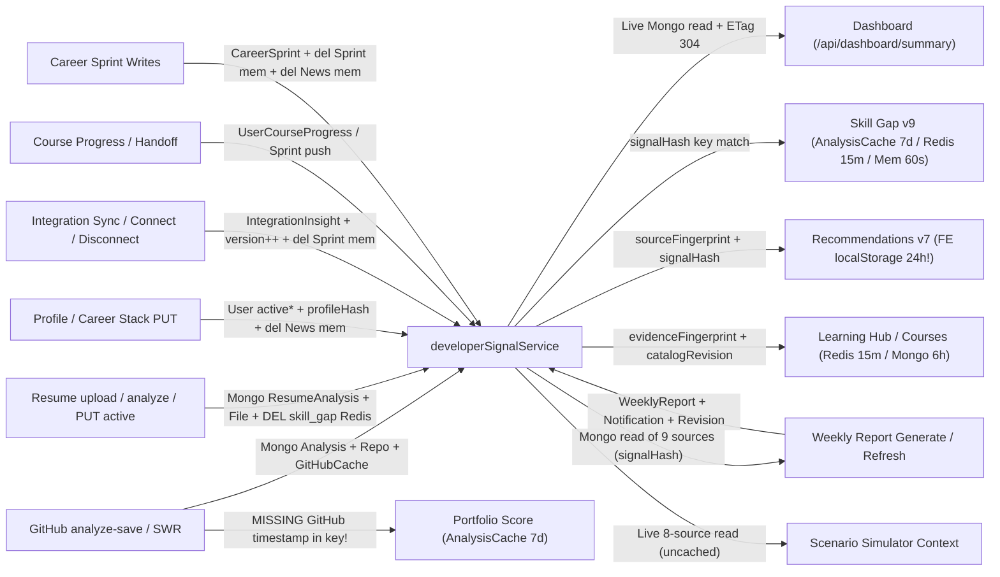

# Cross-Module Data Freshness & Dependency Map — Developer Portfolio Analyzer

This map documents **how writes in upstream modules propagate (or fail to propagate)** to downstream caches and UI views across DPA.

---

## 1. Cross-Module Signal & Cache Propagation Graph

---

## 2. Authoritative Upstream -> Downstream Propagation Matrix

| Upstream Event / Mutation | Backend Propagation Mechanism | Frontend Propagation Mechanism | Downstream Modules Immediately Fresh | Modules Showing Historical / Potentially Stale Snapshots |
|---|---|---|---|---|
| **GitHub `analyze-save` (`githubcontroller.js`) or Background SWR (`githubservice.js`)** | Writes `GitHubAnalysisCache` (`24h`), `Analysis`, `Repository`, `User.githubUsername`. Calls `invalidateDashboardSummaryCache` (no-op) & `invalidateSkillGapCachesForGitHub` (**bug: deletes `v6` instead of `v9`!**). **Implicitly** updates `githubCachedAt` / `githubEvidence` inside `developerSignalService` (`signalHash`) and `evidenceFingerprint`. | `GithubService.analyzeAndSave` calls `clearDeveloperSignalCaches()` + `clearGithubCaches()`. `ApiService.analyzeGitHub` calls `clearDeveloperSignalCaches()`. | **Dashboard** (live read), **Skill Gap** (`signalHash` changes on `githubCachedAt`), **Courses** (`evidenceFingerprint` changes), **Weekly Reports** (`signalHash` changes on *next* `generate`/`refresh`, not old reports), **Scenario Context**, **Tech News**, **Jobs**. | **Portfolio Score (`/api/analysis/portfolio-score`)**: **STALE up to `7d`** (`cacheKey` omits GitHub timestamp/hash!). **Saved `CareerSprint` / `WeeklyReport` / `Recommendation`**: preserve point-in-time snapshots until explicitly regenerated or refreshed. **Other browser tabs**: `Recommendations` stays cached up to `24h` in `localStorage`! |
| **Resume `upload`, `analyze` (new), or `PUT /api/resume/active`** (`resumecontoller.js`) | Writes `ResumeFile` / `ResumeAnalysis` / `ResumeAnalysisCache` (`30d`), updates `User.activeResumeFileId` / `defaultResumeFileId`. Calls `invalidateResumeDependents(userId)` -> `aiService.invalidateCachePrefix('skill_gap:result:<userId>:')`. Updates `resumeHash` & `resumeAnalysisId`. | `ApiService` mutations call `clearDeveloperSignalCaches()` + `clearResumeCaches()`. (`ResumeService` `30d` `localStorage` cache is cleared via `clearAllUserCaches` / `clearCache`, though unused by `ResumeAnalyzerComponent`.) | **Dashboard**, **Skill Gap**, **Portfolio Score** (`resumeHash` & `resumeAnalysisId` in key), **Recommendations**, **Courses**, **Career Sprint** (`context.fingerprint` hashes evidence), **Scenario Context**, **Weekly Reports** (on next generate/refresh). | **Other browser tabs / devices**: `Recommendations` `24h` `localStorage` & `ProfileService` `5m` `localStorage` (`devinsight_profile_cache` retains old `activeResumeFileId` unless reloaded/invalidated). **Existing `CareerSprint` tasks**: unchanged until user imports/generates. |
| **Profile / Career Stack Update (`PUT /profile/me`, `/career`, `/career/active`)** (`profilecontroller.js`) | Updates `User`, recomputes `profileHash`. If changed, calls `invalidateProfileDependentRuntimeCaches(userId)` -> `invalidateNewsSignalCache(userId)` + `invalidateDashboardSummaryCache` (no-op). Every request resolves `active*` stack via `developerContextService`. | `CareerProfileService` & `ProfileService` call `clearProfileCache()`, `clearDeveloperSignalCaches()`, and dispatch `devinsight:profile-personalization-changed` + `localStorage` cross-tab `storage` events. `ApiService.clearScenarioCaches()` aborts inflight scenario reads. | **Dashboard**, **Skill Gap**, **Recommendations**, **Courses**, **Jobs**, **Tech News**, **Career Sprint**, **Scenario Context**, **Public Portfolio** (key hashes `[content, user]`). | **Same user across multi-worker News**: `newsService.signalCache` (`15s` TTL) only clears on the worker handling `PUT /profile`; peer workers lag max `15s`. **Saved historical `WeeklyReport` / `CareerSprint`**: keep their week's stack snapshot unless refreshed (`CareerSprint` history attaches draft compatibility flags). |
| **Integration Sync (`integrationSyncService` worker or `POST /sync-now` / webhook / disconnect)** | Transaction updates `IntegrationConnection`, `IntegrationInsight`, `IntegrationSyncLog`, increments `User.integrationMutationVersion++`. Calls `integrationPersistenceService.invalidate(userId)` -> invokes `invalidateCareerSprintCache` + `invalidateDashboardSummaryCache`. Also updates `portfolioIntegrationRevision` (`AnalysisCache` key). | Frontend manual actions (`oauthCallback`, `manualConnect`, `ingest`, `syncNow`, `disconnect`) call `clearDeveloperSignalCaches()`. Background 30m worker sync pushes **zero frontend invalidation** (unless notification triggers SSE? Sync logs do not emit SSE notifications). | **Dashboard** (`IntegrationInsight` + `SyncLog` read live), **Career Sprint** (`overviewCache` cleared on executing worker; `revision` hash also changes on `IntegrationInsight.updatedAt`), **Portfolio Score** (`portfolioIntegrationRevision` changes), **Scenario Context**, **Skill Gap / Recommendations** (next server check via `signalHash`). | **Frontend `Recommendations` (`24h` `localStorage`)** & **Weekly Reports (`10–15m` `localStorage`)**: will **not** know a background 30m integration sync ran until manual refresh, TTL expiry, or another tab's `currentSignalHash` check! **Admin / Recruiter analytics**: `adminConsoleService.performanceCache` stays stale up to `5m`. |
| **Courses Progress (`PUT/DELETE /courses/:id/progress`) or Handoff (`POST /courses/:id/career-sprint`)** | Upserts/deletes `UserCourseProgress`. Progress controller calls `invalidateDashboardSummaryCache` (no-op). Handoff atomically `$push`es task into `CareerSprint` & calls `invalidateCareerSprintCache(userId)`. | `CourseLearningStore` updates reactive signals. `CourseService.addToSprint()` calls `clearCareerSprintCaches()`. | **Dashboard** (`UserCourseProgress` & `CareerSprint` live), **Career Sprint** (`overviewCache` cleared + `sprint.tasks` hash changes -> always re-fetched on entry), **Weekly Reports** (on next generate/refresh, tracks `UserCourseProgress`). | **Courses progress** does NOT trigger `clearDeveloperSignalCaches()` on FE (doesn't bust `Weekly Reports` `10–15m` `localStorage` cache if user visits Weekly Reports right after completing a course!). |
| **Recommendations Handoff (`POST /recommendations/:id/career-sprint`) & Scenario Export (`POST /simulator/create-sprint`)** | Both atomically mutate `CareerSprint` (`$push` task or draft `aiPlans`) and call `invalidateCareerSprintCache(userId)` (`Recommendations` checks `signalHash === expectedSignalHash` before pushing). | `RecommendationsService.handoffToSprint` clears `career-sprint`, `dashboard`, `weekly-reports`. `ApiService.createSprintFromScenario` clears `clearDeveloperSignalCaches()` + scenario inflight. | **Career Sprint**, **Dashboard**, **Weekly Reports** (recomputed on generate/refresh). | Existing saved `Recommendation` / `ScenarioSimulation` docs keep their snapshots. |
| **Career Sprint Task Complete / Edit / Delete / Restore (`careerSprintController.js`)** | Optimistic `__v` update on `CareerSprint` (+ `Notification` on toggle/restore), calls `invalidateCareerSprintCache(userId)`, `invalidateNewsSignalCache(userId)` (skipped on restore/saveAiPlan/importScenario), `invalidateDashboardSummaryCache` (no-op), `invalidateContextCache` (no-op). | `CareerSprintService` mutations clear `career-sprint`, `dashboard`, `weekly-reports`, `scenario`, `news` (if `newsContextChanged`), `recommendations`, `jobs` frontend caches. | **Career Sprint**, **Dashboard**, **Scenario Context**, **Tech News**, **Skill Gap / Recommendations / Weekly Reports** (on server via `CareerSprint` in `signalHash`). | Peer backend workers retain `overviewCache` up to `60s` ONLY if `revision` matched (it won't because `sprint.updatedAt`/`tasks` hash changes!). |
| **New Interview Prep Session / Custom Q&A / Ingest / Maintenance** (`interviewPrepService.js`) | Private `InterviewPrepSession` saved (`practice` or `custom`). `generate` / `ingest` / `maintenance` upsert `InterviewQuestionBank` & call `invalidateInterviewPrepCache(topic)` (rotates Redis `UUID` revision). `deleteSession` deletes `interview:custom:*` key. | `InterviewPrepComponent` sets `historyLoaded = false`, updates local session list; `History` & `WeeklyReports` read Mongo `InterviewPrepSession` directly. | **Interview Prep History** (direct Mongo read), **Weekly Reports** (counts `InterviewPrepSession` on next generate/refresh), **All workers** (via Redis revision UUID). | **Weekly Reports `10–15m` `localStorage`**: completing an Interview session does **not** clear `WeeklyReportService` `localStorage` cache (`clearDeveloperSignalCaches()` not called on Interview session mutations). |
| **Weekly Report Generate / Refresh (`weeklyReportService.js`)** | Aggregates `9+` Mongo sources; smart-skips AI if `signalHash` unchanged; saves `WeeklyReport` + `WeeklyReportRevision` + `Notification` (triggers SSE!). Calls `invalidateDashboardSummaryCache` (no-op). | `WeeklyReportService` calls `clearDeveloperSignalCaches()` before caching newly returned `/latest` & `/history` in `localStorage`. | **Weekly Reports**, **Dashboard** (`WeeklyReport` summary card), **Notifications** (live SSE push), **Skill Gap / Recommendations / Career Sprint** (`signalHash` includes `WeeklyReport`). | **Scheduled Monday `08:00` cron report**: updates Mongo & sends SSE notification + email, **but if browser stays on `localStorage` (`15m` latest / `10m` history)**, opening Weekly Reports within `15m` shows previous report until TTL or Refresh! |
| **Public Portfolio Update (`PUT /public-profiles/me`) & Avatar Upload (`POST /profile/avatar`)** | Writes `PublicProfile` / `User`, commits `StoredAsset` B2 assets. `invalidatePublicProfileCacheForUser` is intentional no-op because `publicPortfolioCacheService` uses SHA-256 `[content, user]` content-addressed keys. | `PublicProfileService.updateMyPublicProfile` cancels reads, broadcasts on `BroadcastChannel('devinsight-portfolio')`, clears `public-portfolio`, `dashboard`, `scenario`, `weekly-reports` FE caches. `ProfileService.uploadAvatar` bumps `avatarVersion` (`?v=<ts>`). | **Public Portfolio** (instant brand-new cache key across all workers; `?preview` bypasses cache), **Dashboard**, **Scenario Context**. | Local filesystem `/uploads/*` uses `Cache-Control: public, max-age=3600, must-revalidate` (though `Navbar`/`Profile` bust avatar URLs with `?v=<ts>`, public unauthenticated image URLs stay browser-cacheable 1h unless filename changes — UUID filenames ensure unique URLs!). |
| **Recruiter Hub Writes (`jobs`, `shortlists`, `matches`, `profile`)** | Direct Mongo writes (zero backend cache in Recruiter). | Calling components invoke `RecruiterHubService.clearCache()`, resetting `dashboard$` and `analytics$` `shareReplay(1)`. | **Recruiter lists/details** (no cache) & **Recruiter Dashboard/Analytics** (cleared in current tab). | **Admin Performance (`/api/admin-console/performance`)**: remains stale up to `5m` in `adminConsoleService.performanceCache`! **Same-tab account switch**: `RecruiterHubService` retains `dashboard$`/`analytics$` across logout! |
| **Admin Writes (`recruiters`, `teams`, `jobs`, `invitations`)** | Direct Mongo writes (`Organization`, `Team`, `User`, `Job`, `Invitation`, `Membership`). **NO invalidation of `adminConsoleService.performanceCache`.** | **Bug**: `AdminJobsPageComponent` & `AdminTeamsPageComponent` drop same-page list reloads due to `distinctUntilChanged` + `patchQuery`. `AdminConsolePageComponent` `tabStates` only clears active tab / in-page mutations. | **AdminRecruiters`, **AdminDevelopers** (live Mongo). | **Admin Performance (`5m` process Memory Map)** across all workers; **AdminJobs / AdminTeams** same-page UI grid after mutation; **AdminConsole tabs** mutated from external `/app/admin/*` routes. |
| **Super Admin Settings Update (`PUT /api/super-admin/settings`)** | Writes `PlatformSettings` (`scope: 'global'`) to Mongo & updates `settingsCache` **only in the single Node process handling the PUT**! | `MaintenanceModeService` & `authInterceptor` react on `503` maintenance response during API calls. | Current worker's `getSettingsSnapshotSync()` readers (`maintenanceMode`, AI config, rate limits, OTP/JWT settings). | **ALL peer backend workers**: keep old `settingsCache.value` **indefinitely** (`getSettingsSnapshotSync()` never checks `expiresAt` or triggers Mongo reload!). |

---

## 3. Summary of Sync Gaps Between Modules

1. **Multi-worker process-local caches without pub/sub invalidation**:
   - `platformSettingsService.settingsCache` (critical: `*Sync()` skips expiry check!).
   - `adminConsoleService.performanceCache` (`5m`, no write invalidation even on the same worker).
   - `newsService.signalCache` (`15s` lag on peer workers after profile/sprint write).
   - `courseCatalogSearchService` / `sharedCourseCatalogService` (`5–30s` lag on peer workers after catalog ingestion; `jobController.coursePoolCache` `15m` lag).
   - `redisCacheService.memoryCache` (`3600s` memory promotion bug keeps `900s` Courses / `120s` Sprint entries longer if hash didn't change).
2. **Backend `Portfolio Score` (`portfolio-score-v1`) missing GitHub key factor**: Unlike Skill Gap v9 (`signalHash` checks `githubCachedAt`) and Recommendations v7 (`sourceFingerprint`), `analysiscontroller.js` `cacheKey` only hashes `{ githubUsername, careerStack, experienceLevel, resumeHash, resumeAnalysisId, analysisVersion }`, so refreshing GitHub does **not** invalidate cached Portfolio Scores.
3. **Frontend cross-tab / cross-session drift**:
   - `RecommendationsComponent` (`24h` `localStorage`) and `WeeklyReportService` (`10–15m` `localStorage`) can conceal server-side or scheduled updates across `F5` / `Ctrl+Shift+R`.
   - `CoursesComponent` progress completion and `InterviewPrepComponent` session completion do not invalidate `WeeklyReportService` `localStorage` cache (`10–15m`).
   - `ApiService.organizationsCache$` and `RecruiterHubService` (`dashboard$`/`analytics$`) are not registered with `FrontendCacheInvalidationService.clearAllUserCaches()`.

## Implementation addendum — 2026-11-17

GitHub invalidation now targets v9-skill-evidence-governance instead of legacy v6, scopes foreground invalidation by owner, and clears the actual skill_gap:result:<userId>: Redis prefix. Portfolio cache reuse requires a fingerprint of GitHub/resume/career inputs as well as its existing integration revision. Course progress and interview completion invalidate Dashboard/report browser caches. Dashboard listens to scoped same-tab/cross-tab revision events.

The original audit above is historical source evidence. Current implementation and acceptance limits are recorded in [DEVELOPER-DATA-FRESHNESS-FINAL.md](DEVELOPER-DATA-FRESHNESS-FINAL.md) and [DEVELOPER-MODULE-REFRESH-TEST-MATRIX.md](DEVELOPER-MODULE-REFRESH-TEST-MATRIX.md).
