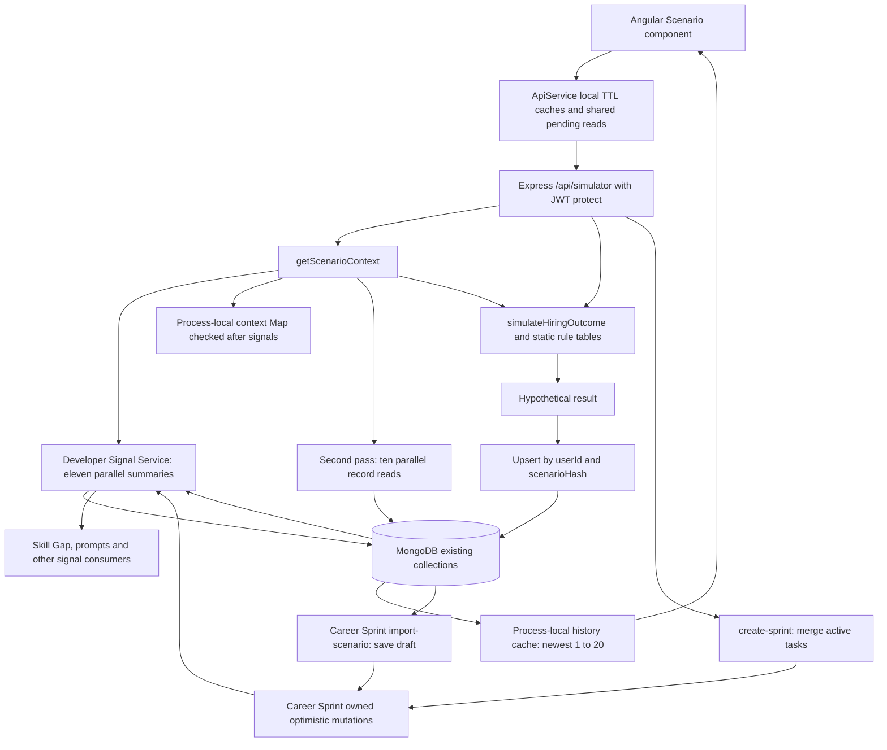
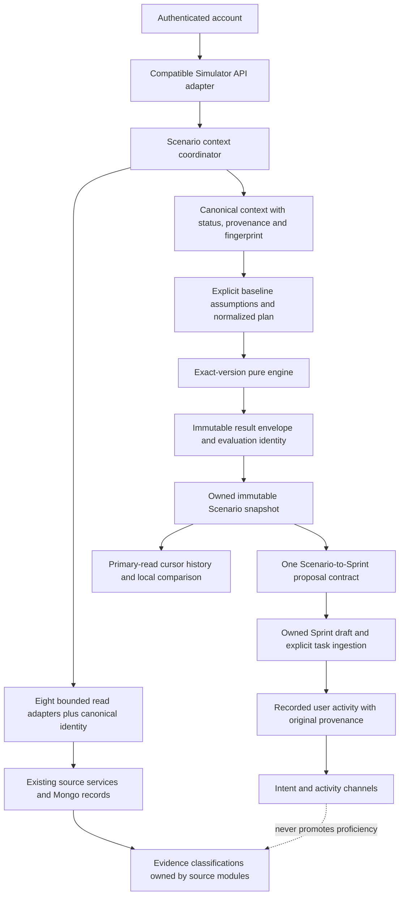

# Scenario Simulator architecture review

Assessment date: 25 October 2026 (Asia/Karachi). Repository revision: `811b54f8`.
Scope: architecture assessment and this report only. Initial working tree was clean.
No application source, locked module, dependency, database, index or production data was changed.

## 1. Decision and verification status

The existing feature is a useful deterministic planning prototype, but it is not ready for a production correctness claim. Its main problems are identity collisions between differently scored plans, unsafe baseline composition, loss of healthy context on dependency failure, mutable saved results, and inconsistent meanings of Sprint export. These require a coordinated change with explicit version boundaries, rather than independent patches.

**CURRENT ARCHITECTURE VERIFIED: YES**

Verified against checked-out source and the local installed runtime; this does not verify a deployed environment.

**SCORING & DATA TRUST VERIFIED: NO**

Bounds and repeatability pass the checks below, but demonstrated identity, zero-handling and trust defects prevent approval.

**INTEGRATIONS VERIFIED: NO**

Source contracts and database-free integration tests were inspected/run. Actual Scenario HTTP/Mongo concurrency, deployment isolation, failure recovery and downstream evidence behavior still need the acceptance tests below.

**SCALABILITY RISKS IDENTIFIED: YES**

**TARGET ARCHITECTURE DEFINED: YES**

**READY FOR COORDINATED IMPLEMENTATION: YES**

This means the design and implementation sequence are actionable. It does not authorize changing locked modules, running migrations, or deploying. Changes at shared/locked boundaries must be coordinated with their owners, with the contracts below tested before rollout.

### Evidence method and limits

Read `AGENTS.md`, the complete Scenario service/controller/routes/model/test/component, API cache implementation, Developer Signal Service, developer context resolver, shared scoring foundation, relevant source models, Sprint normalization/import/retry/cache/provenance code, authentication/rate-limit/metrics/startup code, and retained verification reports. Source function names below identify the relevant implementation even if line numbers move.

No separate Scenario overview document was attached or found among repository Markdown files by scenario/overview discovery. The request's overview and existing service comments were treated as claims to check. No production endpoint or database was contacted. No environment secrets were printed. Existing integration scripts that load `backend/.env` or migrate/delete records were inspected rather than executed.

## 2. Verified current architecture

### Runtime and deployment assumptions

| Item           | Verified local value / implication                                                                                                                              |
| -------------- | --------------------------------------------------------------------------------------------------------------------------------------------------------------- |
| Node / npm     | `v24.19.0` / `11.17.0`; frontend declares `npm@10.9.4`, so package-manager reproducibility differs                                                              |
| Backend        | Installed Express `5.2.1`, Mongoose `9.2.4`, MongoDB Node driver `7.1.0`, express-rate-limit `8.3.1`                                                            |
| Frontend       | Installed Angular core/CLI `21.2.1`, TypeScript `5.9.3`, RxJS `7.8.2`, Prettier `3.8.1`                                                                         |
| Compatibility  | Local Node/TypeScript/RxJS match Angular 21's documented compatibility ranges; installed Mongoose/driver require Node >=20.19                                   |
| Startup        | `backend/index.js` connects Mongo, attempts optional Redis, mounts Express routes, and starts several background workers/schedulers per process                 |
| Mongo settings | `serverSelectionTimeoutMS:30000`, `socketTimeoutMS:45000`; no Scenario-specific query/request deadline or explicit production index policy                      |
| Deployment     | Server version/topology, replica count, actual indexes, proxy settings, pool sizing, write concern, gateway quotas and deployed package versions are unverified |

Package ranges are not deployed-version evidence. No container/CI deployment manifest or Node version pin was found in the inspected file inventory. Check actual release images and topology before choosing rollout settings. Compatibility reference: [Angular version table](https://angular.dev/reference/versions).

### Eight displayed sources, with additional hidden work

`loadScenarioContext` first awaits `getDeveloperSignals`. That function launches eleven summaries: GitHub, Resume, Skill Gap, Career Sprint, Weekly Report, Portfolio, Integrations, Career Profile, Jobs Demand, Recommendations and Scenario history. Scenario displays eight source cards; profile is identity, while Weekly Report and Scenario history are extra reads. `buildSignalHash` includes Weekly Report but excludes Scenario history. Saving a Scenario therefore does not automatically change this hash.

After the signal aggregation, a cache miss launches ten more queries: User, latest Analysis, selected Resume analysis, SkillGraph, Recommendations (12), current Sprint, latest Sprint, PublicProfile, IntegrationInsight and connected IntegrationConnections. Nested resolvers add reads. In an empty-source stub fixture with an active Resume selection, a miss performed 23 model calls and a subsequent reported context cache hit still performed 12. These are fixture-specific counts, not a universal query count or live latency measurement.

| Displayed source | Current acquisition and trust issue                                                                                                                                                                                                                                                        |
| ---------------- | ------------------------------------------------------------------------------------------------------------------------------------------------------------------------------------------------------------------------------------------------------------------------------------------ |
| GitHub Analyzer  | Developer signals choose Analysis by `updatedAt,createdAt`; Scenario separately chooses by `createdAt`. Queries are user-owned but do not establish compatibility with the selected GitHub identity. `analysis.missingSkills` is also added to `githubSkills`, then to `knownSkills`.      |
| Resume Analyzer  | Shared resolver correctly selects active/default owned Resume and avoids borrowing an unrelated historical analysis for an unanalyzed selection. ATS and keyword values are later mixed into unrelated baseline axes.                                                                      |
| Skill Gap        | Signal service reads the latest AnalysisCache with nonempty missing skills; Scenario also reads latest SkillGraph. Scenario does not require current identity/stack/evidence version compatibility. It ignores the stronger existing `skill-evidence-coverage-v1` classification contract. |
| Recommendations  | Latest 12 records plus summary; no Scenario-side matching stack/experience/snapshot validity filter. Suggested learning targets are intent, not ability.                                                                                                                                   |
| Career Sprint    | Signal summary selects latest updated Sprint; Scenario selects a current window or latest Sprint. Those can differ. Incomplete task titles and roadmap focus become suggested skills without semantic normalization.                                                                       |
| Public Portfolio | Claims, project presentation and upcoming work feed suggestions; completeness contributes to baseline. Existing and upcoming projects are both suggested as future score-improving work.                                                                                                   |
| Integrations     | Stored inferred skills and provider summaries; source connectedness is not skill verification. Provider timestamps exist, but Scenario applies no freshness eligibility rule.                                                                                                              |
| Jobs Demand      | Shared global sample of up to 250 unexpired jobs. Presence contributes a synthetic `55` to job-match baseline. Top demanded skills are displayed; actual skill scoring uses the static `marketDemand.js` table, not this sample.                                                           |

Sources expose `connected` and a timestamp, without distinguishing missing, stale, failed, incomplete, incompatible or claimed data. Both aggregation stages use `Promise.all`. The outer catch returns an entirely synthetic 55/48 Full Stack context with `sources:[]`, even when only one source failed. Missing healthy-source data is not distinguishable from a complete dependency outage in that fallback.

### Current request and persistence contracts

All routes in `backend/src/routes/scenarioSimulator.routes.js` use `protect`; authenticated owner identity comes from `req.user._id`.

| Route                                          | Current behavior                                                                                                            |
| ---------------------------------------------- | --------------------------------------------------------------------------------------------------------------------------- |
| `GET /api/simulator/context?forceRefresh=true` | Rebuilds the Scenario layer; does not guarantee that upstream stored analyses are freshly recalculated                      |
| `POST /api/simulator/what-if`                  | Validates client baselines and plan; loads current context; returns `{message,result}`                                      |
| `POST /api/simulator/save`                     | Recomputes from posted inputs/current connectedness; upserts `{userId,scenarioHash}`; returns 201 even for existing records |
| `GET /api/simulator/history?limit=8`           | Newest created records, bounded to 1–20; full `result` included; no cursor or total history traversal                       |
| `DELETE /api/simulator/:id`                    | Owner-filtered delete; malformed ID can become generic 500 rather than bounded client error                                 |
| `POST /api/simulator/create-sprint`            | Recalculates posted plan; adds up to four learning/two project tasks directly to current Sprint                             |
| `POST /api/career-sprints/:id/import-scenario` | Separately loads owned saved Scenario (or latest), creates a named reviewable draft                                         |

`scenarioSimulation.js` declares unique `{userId:1,scenarioHash:1}`, history `{userId:1,createdAt:-1}`, standalone user/hash indexes and `{userId:1,role:1,experienceLevel:1}`. Only the unique and history patterns have demonstrated Scenario query use. Actual deployed indexes are not established by schema declarations. The migration script removes duplicates, drops nonunique compound indexes, creates the unique index and creates/deletes verification records: it is not a read-only index verifier and was not run.

History is user-owned and deletion is scoped correctly. Upsert handles duplicate-key races by rereading the existing owned record. However `$set` replaces its name, normalized inputs, result and source summary, so concurrent callers can return different snapshots for one identity. No engine/table version or complete scoring context snapshot is persisted.

### Frontend and cache behavior

The standalone OnPush Angular component embeds local interfaces, edits baselines with `ngModel`, loads context/history with `forkJoin`, compares saved values locally and loads saved `result` directly. There is no server-side comparison/recalculation endpoint. Comparison has no compatibility guard for different baselines, context or rule versions.

Backend Maps: context 5 minutes, history 1 minute, each default maximum 250 entries; pending Maps have no global admission bound/deadline. Keys include user identity on the backend. History invalidation affects only the current process and does not prevent an older in-flight read from repopulating it.

Frontend Maps: context 15 minutes, history 5 minutes, maximum 50 entries, pending RxJS `shareReplay({refCount:false})`. Keys include profile signature/hash but not an explicit authenticated account ID. Login/logout clears user caches through `auth.service.ts`; nevertheless clearing a pending Map neither cancels its request nor prevents an old callback from writing into the next session's cache. This is a possible cross-session disclosure race, not a demonstrated account exploit.

Input changes do not invalidate `result`; save/export build a payload from current editable fields rather than the displayed simulation inputs. Bootstrap/profile refresh can reset the form; a boolean refresh guard can drop a second profile change; several HTTP subscriptions are not added to the component teardown subscription. Typed API models, request generations and an immutable displayed result are missing.

## 3. Findings and severity

“Demonstrated” means directly shown by code plus the stated executable probe when applicable. “Risk” means a plausible consequence requiring production/integration evidence. No Critical defect was demonstrated; this does not certify absence of security defects.

| ID  | Severity / classification                                      | Finding and evidence                                                                                                                                                                                                                                                                                                                                                                                                                                                                                                                                                                |
| --- | -------------------------------------------------------------- | ----------------------------------------------------------------------------------------------------------------------------------------------------------------------------------------------------------------------------------------------------------------------------------------------------------------------------------------------------------------------------------------------------------------------------------------------------------------------------------------------------------------------------------------------------------------------------------- | --- | -------------------------------------------------------------------------------------------------------------------------------------------------------------------------------------------------------- |
| F01 | High — demonstrated                                            | **Hash/scoring identity conflict.** `buildScenarioHash` sorts skills/projects, while `computeSkillImpact` and `computeProjectImpact` apply index-dependent diminishing returns. Reordering projects produced hiring 56 versus 53 under the same hash; skills produced 52 versus 54. Saves can overwrite a materially different result under one identity.                                                                                                                                                                                                                           |
| F02 | High — demonstrated                                            | **Baseline has no defensible shared meaning.** `loadScenarioContext` averages positive-only User score, readiness, ATS (twice through record/signal), coverage and portfolio completeness for hiring; job match combines unrelated skill/GitHub/keyword scores plus job presence. Measured zeros disappear. Duplicate source measurements get extra weight. Foundation documentation explicitly leaves Simulator baseline policy unmigrated; placeholder Developer Score is not approved authority.                                                                                 |
| F03 | High — demonstrated                                            | **Context failure destroys available evidence.** Injecting a rejection for each of the eight displayed source models independently caused the whole context to become 55/48 with zero source cards. Neither stage has an explicit Scenario deadline. Ordinary what-if requests depend on these reads.                                                                                                                                                                                                                                                                               |
| F04 | High — demonstrated                                            | **Saved calculations are mutable/unversioned.** Same hash upsert replaces snapshots; confidence depends on current Resume/GitHub connectedness that is absent from the hash. Source summary does not preserve all scoring inputs or versions. Displayed what-if and saved result can diverge.                                                                                                                                                                                                                                                                                       |
| F05 | High — demonstrated trust defect; propagation impact is a risk | **Ability and intent are not consistently separated.** Missing GitHub skills enter Scenario `knownSkills`. Developer Signal Service's `completedSkillSignals` extracts `sprint.goalTechnology` even without requiring completed tasks; `promptBuilderService` calls these `completedSkills`, and legacy Skill Gap paths consume them. Modern `skillGapEvidenceService` accepts only github/resume/profile/integration sources, so this is not proof that its current coverage engine promotes hypothetical skills. Consumer-specific contamination still requires end-to-end tests. |
| F06 | High — risk supported by implementation                        | **Cross-instance and late-response cache inconsistency.** History uses user/limit TTL keys and local invalidation only. In-flight work can repopulate invalidated backend/frontend caches. User-switch races lack explicit account/generation guards. No current multi-instance Scenario consistency test was found.                                                                                                                                                                                                                                                                |
| F07 | Medium — demonstrated                                          | **Zero project impact becomes 65.** `(Number(project.impact)                                                                                                                                                                                                                                                                                                                                                                                                                                                                                                                        |     | 65)` assigns default benefit to valid zero. At 24 weeks, one medium/3-week project scores 6.6 points at impact 0, 0.1 at impact 1, and 6.6 at impact 65. Frontend cloning separately changes zero to 70. |
| F08 | Medium — demonstrated                                          | **Heuristic confidence presented like prediction.** A weighted recipe rewards plan size, connected analyses, role fit and duration. Range width is a formula, with no empirical calibration/coverage validation found. “% confidence”, “expected”, “realistic” and “hiring/job match” overstate known evidence despite `guaranteed:false`.                                                                                                                                                                                                                                          |
| F09 | Medium — demonstrated                                          | **Inconsistent effort units.** `timeEstimator` sums effort in weeks and uses capacity `0.8*duration`; duration suggestion divides the same effort by 6.5. Severe overload may still receive positive improvement, because penalty is capped at 20 and gains at 40. Suggested duration may exceed the API maximum (24 -> 26).                                                                                                                                                                                                                                                        |
| F10 | Medium — demonstrated                                          | **Input coercion/default bugs.** Explicit duration 0 passes as 6. `Number(null)`/`Number(false)` accept baselines as zero; object skill values can stringify into valid names. Fractional weeks are silently rounded by the integer clamp. Unsafe duplicate project fields can be discarded before validation. Engine silently uses sanitized values even if direct-call validation would fail.                                                                                                                                                                                     |
| F11 | Medium — demonstrated                                          | **Two export meanings and builders.** Simulator UI says draft while its endpoint adds active incomplete tasks. Career Sprint import actually saves a draft, with different task types, priorities/points and scheduling. Direct export uses wall-clock host dates, not target Sprint scheduling; truncation denominator counts more tasks than actually exported. Existing title dedupe is edit-sensitive rather than durable source-item identity.                                                                                                                                 |
| F12 | Medium — demonstrated                                          | **Error and contract mismatch.** Simulator controller maps Sprint 404/409/413 and legacy-policy errors to generic 500. Valid Scenario project/skill names can exceed Sprint task-title limits after `Build `/`Learn ` prefixes. Owned supplied Scenario ID is checked downstream but its content hash is not bound to the submitted plan. UI does not pass the loaded saved Scenario ID.                                                                                                                                                                                            |
| F13 | Medium — risk                                                  | **Rate/fan-out/resource amplification.** Global limiter defaults to 500/15 minutes (higher in development), uses verified JWT owner or IP, and has no external store. Each backend process has its own counter. There is no Scenario-specific refresh/write quota or total context-work admission bound. Scale-out increases both quota and duplicate reads.                                                                                                                                                                                                                        |
| F14 | Low — demonstrated limitation / potential risk                 | **History and index inefficiency.** Twenty-record cap is not pagination. Created-time sort has no ID tie-breaker; repeat save changes updatedAt but not history ordering. Standalone hash and role/level indexes lack demonstrated workload use; removal still needs index-usage/explain evidence.                                                                                                                                                                                                                                                                                  |
| F15 | Low — demonstrated observability gap                           | **Timing logs are insufficient.** Context/history/save timing and generic HTTP metrics exist, but no per-source status/timeout, engine-version, admission, dedupe or cache-effectiveness metrics. Fallback success responses hide degraded availability from ordinary HTTP error counts.                                                                                                                                                                                                                                                                                            |

### Confirmed strengths to preserve

- Core numeric simulation performs no AI calls, database access or wall-clock reads. Its hosting service nevertheless imports persistence/integration dependencies, so it is not an isolated engine module.
- Scores/ranges are bounded; combined improvement is capped; valid source-zero handling primitives already exist in `scoring/math.js`.
- Input list/text limits and JSON body limit (100 KB) bound most per-request payload work. Generic internal errors do not expose database internals in responses.
- Resume identity selection is centralized; authentication checks JWT algorithm/issuer/audience and active account state; Scenario save/history/delete use authenticated ownership.
- Sprint uses owned lookups, optimistic concurrency, five version-conflict attempts, 500-task bound, read-only legacy guards and cache invalidation. `normalizeTask` creates incomplete tasks; export does not directly grant XP, completion or proficiency.
- Existing evidence classifications and exact-version scoring registry provide patterns to reuse without changing locked scoring engines.

### Claims not established

The service comment's deterministic formula does not prove order-independent identity, statistically valid forecasts, live-market scoring, immutable saved history or production scalability. A declared unique index does not prove index installation. Local pending-request sharing is not distributed deduplication. A force refresh is not upstream reanalysis. “Safe defaults” are hypothetical assumptions, not observed ability.

Retained `backend/verification/career-sprint/REPORT.md` describes earlier passing runs. The later `backend/verification/career-sprint/lock-verification/REPORT.md` explicitly says **BLOCKED / READY TO LOCK CAREER SPRINT: NO**, reports 372/376 in its latest full backend run, performance failures and a Windows Node/libuv abort, despite separately passing worker/integration/frontend checks. Those are historical evidence, not this assessment's rerun results. Do not use the earlier green report to waive the later gates, and do not edit Sprint to resolve them during this assessment.

## 4. Target architecture and ownership contracts

Keep the modular monolith and current Mongo collections. No AI, new microservice, queue, Redis dependency or new collection is justified for this feature. Separate pure calculations from identity/context/persistence/export orchestration.

The dashed relationship is a prohibition: activity may request future evidence review; it cannot write evidence classifications.

| Owner                          | Required integration contract                                                                                                                                                                                                        |
| ------------------------------ | ------------------------------------------------------------------------------------------------------------------------------------------------------------------------------------------------------------------------------------ |
| `developerContextService`      | Canonical active GitHub/stack/experience/Resume identity, selected owned file IDs; Scenario never independently guesses active identity                                                                                              |
| GitHub/Resume owners           | Bounded score/evidence projections with record ID, identity, recorded rule version, observed/analyzed timestamps and completeness. Missing metadata remains unknown; no new version is stamped on history                            |
| Skill Gap owner                | Compatible `skill-evidence-coverage-v1` result using current identity and requirement context; preserve DEMONSTRATED/PARTIAL/CLAIMED_ONLY/NOT_EVIDENCED/UNKNOWN, without equating evidence classification with certified proficiency |
| Recommendations owner          | Owned compatible snapshot/action targets, stable action IDs and limitations; suggestions remain intent                                                                                                                               |
| Sprint owner                   | Owned target Sprint, calendar policy, writable status, version, stable proposal/import identity, task/draft lifecycle, XP/progress and reservation rules                                                                             |
| Portfolio/Integrations owners  | Distinguish self-claims, linked artifacts and inferred observations; per-provider freshness and source identity, without trusting connectedness as demonstrated proficiency                                                          |
| Jobs owner                     | Role/region/time-window sample metadata, eligible sample size and timestamp; market context is never personal ability                                                                                                                |
| Scenario owner                 | Plan validation/canonicalization, explicit assumptions, engine/version registry, calculation snapshots, user history and exports; never writes upstream scores/evidence                                                              |
| Developer Signal Service owner | Separate `careerIntent`, `recordedActivity`, `demonstratedEvidence` and `marketContext` projections; Scenario predictions cannot enter capability/coverage/achievement channels                                                      |

### Canonical context

Use an additive `contextSchemaVersion` envelope containing canonical profile identity and eight named source results. Each source result contains:

- `status`: `available`, `missing`, `stale`, `incompatible`, `timeout` or `error`; `completeness`: complete/partial/unknown.
- Owned source references and recorded rule/schema versions, `observedAt`, `analyzedAt`, `retrievedAt`, `freshUntil` and a bounded warning code list. Retrieval time cannot renew evidence age.
- A bounded typed projection and `evidenceClass`: demonstrated observation, self-claim, inference, planned intent, recorded activity or market context. Different observations of one skill retain their distinct provenance.
- Eligibility for baseline/display/suggestions separately, with an exclusion reason. Valid zero remains numeric zero; absence remains null.

Fingerprint stable normalized content, source identity/revision, policy version and freshness classification. Exclude transport cache-hit flags and retrieval timestamps. Use an injected `asOf` for age classification; freeze the evaluated classification in saved snapshots. Sort keys and set-like lists with a specified locale-independent comparator; do not hash raw Mongoose objects or arbitrary alias copies.

Initial freshness policy, to be configuration-versioned: GitHub observations 7 days; Resume eligibility requires selected unchanged content and matching analysis version (surface age after 30 days, without asserting content changed); Skill Gap/Recommendations must match current upstream fingerprint and approved rule; Sprint uses fresh owned primary reads; Portfolio/Integration evidence shows age and is marked stale after 30/7 days respectively; Jobs uses source freshness fields, never merely “document not TTL-deleted.” These are design defaults, not empirically verified thresholds. They control eligibility/disclosure, not new scoring weights.

### Baseline authority

There is no approved single hiring/job-match baseline authority today. Do not replace the average with another invented weighted composite. New evaluations require explicit finite 0–100 **planning baseline assumptions**, confirmed by the user, or an explicitly selected, compatible existing metric whose original name/unit/source is preserved. A portfolio score remains a portfolio score; it is not relabeled a hiring probability.

The existing 55/48 defaults may remain as prefilled legacy assumptions for compatibility, with `authority:user-assumption`, `requiresConfirmation:true` and visible provenance. Missing context must not manufacture a measured baseline. Keep observed metrics, user overrides and baseline assumptions separately. The server resolves any claimed source reference and verifies ownership/compatibility; a client-supplied `source` label is never authoritative. Confirmed user assumptions remain usable during upstream outages.

### Pure engine and version policy

Create an exact-version engine entry point accepting only a validated canonical plan, baseline assumptions and the bounded evidence-support facts actually used. It returns numerical outputs, component contributions/cap adjustment, warnings and non-statistical support labels. No database/HTTP/cache/env/Date/random access; freeze rule tables and validate inputs before calling it. Metadata timestamps belong to orchestration.

Preserve legacy behavior under a clearly identified legacy implementation; existing stored results remain unversioned historical records. Do not stamp them with a reconstructed version or overwrite them on read. Register a new `scenario-planning-v2` only for demonstrated fixes: explicit zero handling, canonical ordering/identity, strict validation and consistent duration suggestion. Retain existing relevance/difficulty/demand/level multipliers, skill/project caps, synergy and overload coefficients until separately justified changes are approved.

For v2, rank skills/projects by their pre-diminishing contribution descending, breaking ties by normalized canonical item ID. Apply the existing diminishing factors to that canonical order, regardless of display order. This resolves F01 while minimizing changes to intended stronger-first plans. Full-set canonicalization precedes truncation/validation; incompatible duplicate project definitions fail validation instead of first-writer selection. Introduce only reviewed dictionary aliases, with a versioned mapping; unknown skills remain custom planning terms. Do not silently normalize semantic aliases in historical hashes.

Static demand stays explicitly labeled a versioned heuristic table. Live Jobs sample is advisory; switching to live demand requires a separate rule version and saved sample inputs. Project role relevance and title-based synergy are weak heuristics, not verified quality; disclose them. Do not invent a new project-fit classifier as part of this change.

### Mathematical invariants and product semantics

For valid normalized inputs under the preserved rule family:

1. All numeric outputs finite; scores/range endpoints in [0,100]. Hiring improvement in [0,40], job-match improvement in [0,29], including saturation at 100.
2. Skill/project components each <=22; synergy <=10; overload penalty in [0,20]. Total is clipped after combining components. No overload-induced negative improvement is currently modeled; retain and disclose this assumption.
3. Increasing baseline changes output only through addition/rounding/saturation, not the assumed plan's raw contribution. Increasing plan duration cannot increase overload penalty. Adding work need not improve final score because overload can increase.
4. Same engine/table/context/input versions yield identical full calculation output. Equivalent plan permutations yield identical evaluation identity and numeric output in v2.
5. Zero project impact remains zero project contribution. Do not assert total synergy is zero for such a plan without a separately versioned synergy change.
6. Explainability distinguishes uncapped item points, capped component points, raw total, cap reduction, final applied delta and score saturation. Rounded displayed rows need not sum exactly; show the reconciliation rather than claiming each item independently caused the final gain.
7. Low <= expected <= high remains guaranteed for legacy ranges, but they are **heuristic sensitivity bands**, not calibrated confidence/prediction intervals. The upper band can exceed the central +40 improvement cap; label that distinction rather than promising a probabilistic ceiling.
8. Fix suggested duration to use the same effort-in-weeks capacity `0.8` as overload. If required duration exceeds 24, return an explicit out-of-supported-window warning/required estimate, not an invalid suggested form value. Retain overload threshold discontinuities pending a separately justified version.

Replace UI “% confidence” with evidence support / timeline feasibility descriptions. For old API consumers retain numeric fields additively with `kind:heuristic`, `calibrated:false` and visible limitation text. Do not claim hiring probability, job outcome, completion certainty or statistical coverage. Existing legacy detail fields remain readable. Simulated learning and self-reported completion never become verified proficiency.

## 5. Persistence, identity, APIs and state

### Immutable evaluation snapshots in the existing collection

Separate three identities:

- `planHash`: canonical normalized plan and baseline assumptions, with canonicalization version.
- `contextFingerprint`: eligible inputs/provenance/policy actually used, excluding unrelated Weekly Reports and Scenario intent.
- `evaluationHash`: engine version, rule-table version, planHash and relevant contextFingerprint. A context change can legitimately produce another evaluation of the same plan.

For new records, store `recordSchemaVersion`, all exact engine/table/policy versions, normalized input, baseline authority, bounded complete calculation context, original result, context fingerprint, source references and server calculation metadata. Full Resume text/provider credentials/raw repositories are excluded. Store enough numerical/context facts to reproduce every output even after source deletion; source links are for provenance, not mandatory replay dependencies. Set a 32 KB target per snapshot and a hard 64 KB application bound after serialization.

Keep the existing unique `{userId,scenarioHash}` index initially by setting the new `scenarioHash` to a namespaced/versioned evaluation digest. Preserve old hash values. Use insert-only `$setOnInsert`; duplicate-key recovery returns the identical persisted snapshot. Display name can be a separately version-checked metadata update, never a recalculation side effect. A duplicate save response is additive `{replayed:true}`; retain legacy response shape/status until clients migrate. This avoids a new collection and avoids a redundant second unique evaluation index.

Legacy posted plans can still compute/save through an explicit legacy compatibility adapter. New UI posts a versioned evaluated envelope; the server recomputes its digest/result from submitted bounded inputs and verified source references, then rejects mismatches. A what-if response is not blindly trusted on save. Saved evaluations load unchanged; “Recalculate with current context” creates a new evaluation and may include `recalculatedFromId`. Never update a historical result in place.

### Backward-compatible endpoints and frontend state

Retain current routes and response wrappers. Add optional schema/rule versions, evaluation identity, trust metadata and cursor fields. Do not require new fields for existing clients during transition. Strict validation changes that previously accepted coercions belong to the opt-in v2 contract; all clients still receive safe size/type guards and documented bounded errors.

New UI uses typed shared Scenario models and a feature service. Keep editable draft, immutable evaluated snapshot, saved selection and comparison selection separate. Changes mark the draft dirty and disable exporting/saving that displayed result until re-evaluated; alternatively actions explicitly target the immutable snapshot. Use account ID plus session/profile generation for all caches/requests. Use latest-request semantics for profile refresh, abort/ignore obsolete responses, teardown subscriptions, and preserve the last valid view on failed refresh.

Comparisons show baseline, context date and engine version. Offer like-for-like recalculation as a new snapshot; warn on incompatible contexts/versions rather than silently ranking incomparable outputs. Use stable cursor history ordered by `{createdAt:-1,_id:-1}` with limit 1–20 and `nextCursor`; keep legacy `history` array. Validate cursor/IDs and filter every lookup by owner. Continue returning indistinguishable not-found results for foreign IDs.

## 6. Sprint export, caching, security and operations

### One export proposal, two deliberate lifecycle actions

Use one pure Scenario-to-Sprint task proposal adapter for both callers, with explicit `mode:draft` or `mode:active-tasks`. Default the new UI to an owned saved evaluation -> reviewable draft -> explicit ingestion. Keep the legacy create-sprint route's direct-active semantics for existing callers, but label them correctly. Do not silently turn an existing active-task API into a draft-only API.

Scenario owner resolves the saved evaluation; Sprint owner resolves target Sprint/calendar and validates writable/legacy policy. Bind source ID, evaluation hash and generated items together. Never accept an arbitrary owned ID as provenance for different submitted content. Unsaved legacy plans receive a server-computed intent hash, with no claim of saved Scenario provenance. Both paths share caps, points, source limitations and title-fit validation.

Generate `sourceItemKey` from evaluation identity + canonical skill/project ID, independent of task title, dates and array position. Persist a bounded import receipt in the existing Sprint document containing export key, mode, evaluation hash and created task/draft IDs. Append receipt and tasks/draft in the same optimistic document save; duplicate replay returns the original receipt. Same idempotency key with different content returns 409. Source item keys preserve dedupe after task edits; task deletion must not silently re-import on a retry. Explicit re-import uses a new user-confirmed operation key. Bound receipt retention and operation lifetime; retain source identities for the supported retry window and reject expired keys rather than pretending exact replay forever.

Use Sprint's existing five-attempt optimistic retry and reservation policy, not a separate transaction/lock service. Concurrent different imports must preserve both or return a retriable bounded 409. Single-document atomicity supports tasks plus receipt together; it does not establish cross-document atomicity. [MongoDB atomicity guidance](https://www.mongodb.com/docs/manual/core/write-operations-atomicity/).

Schedule relative to explicit target Sprint calendar/dates, injected planning date and supported capacity. Clip/reject out-of-window proposals explicitly; never silently stretch a week to fit a 24-week plan. Export remains incomplete intent. User completion may change recorded activity/XP under existing Sprint rules, but does not change GitHub/Resume evidence or assert proficiency. Proposal/import must leave XP, streak and completed counts unchanged; adding incomplete active tasks can legitimately change the progress denominator and must be disclosed. A draft alone must not change active progress.

Preserve safe 400/404/409/413/429/503 statuses through the Simulator adapter. Cache invalidation occurs only after committed writes. Historical Scenario deletion leaves recorded Sprint provenance/receipts readable without cascading task deletion.

### Cache correctness without a new shared dependency

Initial target: remove cross-request Scenario history caching and revalidate history against primary Mongo reads. Context gets one bounded read pass, with local pending-request sharing only; stop rereading all signals to validate a cache that merely avoids mapping. Pure engine work is small enough to avoid distributed simulation caching until measured otherwise. This gives consistent multi-instance semantics without Redis invalidation machinery or an additional revision collection.

If measured CPU/mapping cost justifies context/result caching later, accept only immutable keys derived from freshly read relevant source snapshots and exact policy versions, as the existing Sprint overview cache does. An old writer can populate only its old revision key. Do not add user-only TTL caches for authoritative history or mutation decisions. Optional shared Jobs display aggregation may be cached separately with explicit sample timestamp and bounded stale policy; it cannot supply a personal baseline.

Frontend retains pending sharing and immutable snapshot storage; context/history revalidate on navigation, account/profile change and successful dependent writes. Cache display must preserve age/degradation labels. Account/session generation guards prevent late completion after invalidation; cancellation alone is insufficient. Send `Cache-Control: private, no-store` for authenticated context/history responses at HTTP/shared-proxy boundaries. No cross-user cache keys or full source payloads.

Coalesce read work per account/profile/version, without a separate refresh namespace that doubles work. A refresh invalidates display eligibility but cannot launch unlimited parallel pipelines. Pure what-if with explicit assumptions should not require unrelated dependency reads. Exact cross-instance read deduplication is unnecessary for correctness at the proposed workload; duplicated bounded reads are acceptable. Persistence/export idempotency is database-enforced, independent of local dedupe.

### Fan-out, deadlines and recovery

Use a Scenario-specific coordinator calling existing source adapters once. Do not change global `getDeveloperSignals` failure behavior for every locked consumer in the first phase. Prefer typed read-only adapter entry points supplied by those owners; avoid invoking source reanalysis, external providers or public-profile mutation paths.

Initial configurable budgets: at most four simultaneous source operations per context, 750 ms per source, 2 seconds total context deadline, maximum 32 active context pipelines per instance and 256 total joiners. Reject excess distinct work with 503 + Retry-After, not an unbounded wait. A 750 ms timeout must bound actual database operations with supported query/driver cancellation/deadlines; a `Promise.race` alone leaves underlying work running. Validate actual installed driver behavior and Mongo server support in acceptance tests.

Use settled per-source results. Preserve every healthy source when another fails; distinguish missing from failure, return degraded context explicitly, and keep user-assumption simulation usable. No automatic retry storm: at most one budgeted transient read retry if total deadline allows; explicit refresh stays subject to quotas. Fatal authentication/ownership errors fail closed rather than becoming synthetic context. Do not cache transient failures as healthy source state.

### Security and distributed quotas

Keep JWT protection and owner predicates in every service operation. Apply strict v2 numeric/string/object shape validation, unknown-field rejection, integer week limits and finite checks; retain bounded custom skill names and Angular escaped text rendering. Validate source IDs against both ownership and context. Avoid logging source text, email, Resume contents, JWTs or raw user IDs as metric labels.

Keep the existing broad global limiter as defense in depth. Production multi-instance ingress must enforce shared account quotas for validated identity and anonymous IP quotas before application fan-out; do not trust a client-provided account header. Initial Scenario budgets: context 30/minute/account, force refresh 6/minute, what-if 60/minute, saves 20/minute, exports 10/minute, plus per-instance concurrency caps. Return 429 and Retry-After consistently. These are initial operational policies to validate, not measured capacity.

Preferred distributed limiter is the deployment gateway's existing shared quota facility, if available. Its availability is currently unverified and is a release gate. Do not add Redis solely for this assessment, and do not claim process MemoryStore is distributed. If no gateway capability exists, explicitly restrict release to one backend instance with local limits until a shared-store alternative is reviewed. A Mongo-backed limiter in a new collection adds a write to every request and is rejected without workload evidence. Verify configured proxy trust against the actual deployment hop chain; `index.js` does not currently set it.

### Observability

Extend existing Prometheus/tracing facilities with bounded labels: operation, source (eight fixed names), status, rule version and cache tier. Record per-source duration/error/timeout/stale counts; context completeness; active/joined/rejected pipelines; simulation CPU duration; evaluation saves/replays/conflicts; export attempts/replays/retries/conflicts; legacy/v2 usage; cache revalidation/hit/miss/stale/late-drop; response size and DB operation count. HTTP 200 degraded context must increment a degradation metric. Correlate errors by request ID with bounded diagnostic codes. Do not label metrics with account, hash or scenario ID.

## 7. Architecture decision records

| ADR | Decision                                                       | Alternatives and tradeoffs                                                                                                                                                                                                          |
| --- | -------------------------------------------------------------- | ----------------------------------------------------------------------------------------------------------------------------------------------------------------------------------------------------------------------------------- |
| 01  | Modular monolith, isolated pure versioned engine               | Broad rewrite/microservice adds network contracts and operations without demonstrated CPU scaling need. Extracting modules still requires parity tests.                                                                             |
| 02  | Explicit planning baselines; preserve source metric semantics  | Positive-only averaging is incorrect; choosing a new composite would invent product policy. Manual assumptions add a confirmation step but make authority honest.                                                                   |
| 03  | Settled bounded source adapters, one read pass                 | Current fail-fast reads hide partial health; globally changing DSS risks locked consumers. Scenario-specific composition duplicates only orchestration until shared contracts are approved.                                         |
| 04  | Canonical pre-contribution ordering under v2                   | Keeping ordered identity would fix hash collisions but preserve arbitrary UI-order effects. Sorting alphabetically is simple but assigns diminishing benefit by spelling. Contribution ordering minimizes stronger-first surprises. |
| 05  | Immutable evaluations in existing Scenario collection          | Overwriting loses reproducibility. New plan/revision collections are unnecessary at current bounded sizes. Multiple evaluation documents consume more storage but retain meaningful history.                                        |
| 06  | Atomic Sprint receipts/source-item dedupe in existing document | Title dedupe fails after edits; global locks/queues are unnecessary. Embedded bounded receipts fit current single-document mutations; very large lifetime histories would need a separately justified design.                       |
| 07  | Primary revalidation and immutable revision caches only        | TTL-only caches are cheap but inconsistent. Redis is already optional elsewhere; adopting it does not solve invalidation correctness and is not required here. Read cost is accepted pending measurement.                           |
| 08  | Shared ingress quotas; bounded local read singleflight         | Local memory cannot enforce one quota across instances. Database write-per-request limiting/new collection is premature. No ingress facility means multi-instance release remains gated.                                            |
| 09  | Heuristic support labels; no statistical prediction claim      | Keeping percent confidence risks misleading users. Empirical calibration requires real outcome definitions/data and is outside this deterministic architecture assessment.                                                          |
| 10  | Preserve locked source engines and legacy records              | Backfilling or relabeling history would manufacture provenance. Coordinate small additive adapter/intent contracts with owners and preserve unversioned history.                                                                    |

## 8. Prioritized implementation and migration plan

All paths below are repository-relative planned files, not changes made by this assessment. New files are explicitly marked. Respect locked-module boundaries; owner coordination is required before touching shared contracts, even where listed here.

| Stage                          | Exact affected files                                                                                                                                                                                                                                                                                                                                                                                                                                              | Work and migration needs                                                                                                                                                                                                                                                                                     |
| ------------------------------ | ----------------------------------------------------------------------------------------------------------------------------------------------------------------------------------------------------------------------------------------------------------------------------------------------------------------------------------------------------------------------------------------------------------------------------------------------------------------- | ------------------------------------------------------------------------------------------------------------------------------------------------------------------------------------------------------------------------------------------------------------------------------------------------------------ |
| P0: characterization/contracts | `backend/src/tests/scenarioSimulatorService.test.js`; new `backend/src/tests/scenarioSimulatorContracts.test.js`, `backend/src/tests/scenarioSimulatorContext.test.js`; new `frontend/src/app/shared/models/scenario-simulator.model.ts`                                                                                                                                                                                                                          | Lock legacy fixtures and demonstrate F01–F12; define additive envelopes and error codes before changing runtime behavior. No data migration.                                                                                                                                                                 |
| P1: engine                     | `backend/src/services/scenarioSimulatorService.js`; new `backend/src/services/scoring/scenarioPlanningScore.js`, `backend/src/services/scoring/scenarioPlanningLegacy.js`, `backend/src/services/scoring/scenarioPlanningRules.js`; new `backend/src/utils/scenarioIdentity.js`; `backend/src/utils/timeEstimator.js` only if its owner confirms Simulator-only effects                                                                                           | Extract legacy parity; add opt-in v2 canonicalization/zero/duration fixes. Read existing `roleWeights.js`, `skillDifficulty.js`, `marketDemand.js`; freeze/copy versioned rule inputs without silently changing shared tables. Keep global scoring registry unchanged until its owner approves registration. |
| P1: context/trust              | New `backend/src/services/scenarioContextService.js`; `backend/src/services/scenarioSimulatorService.js`; coordinated additive adapters in `backend/src/services/developerSignalService.js` and existing `backend/src/services/developerContextService.js` only where needed                                                                                                                                                                                      | One bounded read pass; source states/provenance; explicit baseline assumptions. Use `backend/src/services/coursePersonalizationService.js` and `backend/src/services/skillGapEvidenceService.js` contracts read-only; do not rewrite their evidence rules.                                                   |
| P1: persistence/API            | `backend/src/models/scenarioSimulation.js`; `backend/src/controllers/scenarioSimulatorController.js`; `backend/src/routes/scenarioSimulator.routes.js`; `backend/src/services/scenarioSimulatorService.js`; new `backend/src/scripts/auditScenarioSimulationSnapshots.js`                                                                                                                                                                                         | Add bounded snapshot/version metadata, insert-only save and cursor history. New script initially read-only: index inventory, duplicates, empty hashes, snapshot sizes and references. Do not run existing destructive index migration as a verifier.                                                         |
| P2: Sprint handoff             | New `backend/src/services/scenarioSprintAdapter.js`; coordinated `backend/src/services/careerSprintService.js`, `backend/src/models/careerSprint.js`, `backend/src/controllers/careerSprintController.js`; `backend/src/services/scenarioSimulatorService.js`                                                                                                                                                                                                     | One proposal builder; source binding, stable item IDs, atomic receipts, calendar-aware scheduling, replay after edit/delete and safe status propagation. Existing drafts/tasks stay readable; no automatic rewriting of historical provenance.                                                               |
| P2: intent propagation         | Coordinated `backend/src/services/developerSignalService.js`, `backend/src/services/promptBuilderService.js`; contract tests against `backend/src/controllers/skillgapcontroller.js`, `backend/src/services/recommendationService.js`, `backend/src/services/newsService.js`                                                                                                                                                                                      | Separate intent/activity/evidence. Remove goal-only completed-skill assertions through an additive compatible projection. Change consumers only after owner review; do not alter locked numeric engines or stored reports.                                                                                   |
| P2: frontend                   | `frontend/src/app/pages/scenario-simulator/scenario-simulator.component.ts`, `frontend/src/app/pages/scenario-simulator/scenario-simulator.component.html`, `frontend/src/app/pages/scenario-simulator/scenario-simulator.component.scss`; `frontend/src/app/shared/services/api.service.ts`; `frontend/src/app/shared/services/frontend-cache-invalidation.service.ts`; new `frontend/src/app/shared/services/scenario-simulator.service.ts`; shared model above | Typed feature state, immutable result actions, explicit assumptions, heuristic labels, cursor history, latest-profile request handling and account/generation cache isolation. Existing `frontend/src/app/shared/services/career-sprint.service.ts` changes only if additive export contract requires them.  |
| P3: operations                 | `backend/src/services/metricsService.js`; `backend/src/middleware/securityMiddleware.js`; `backend/index.js` only for reviewed ingress/proxy integration; new `backend/src/middleware/scenarioSimulatorMiddleware.js`                                                                                                                                                                                                                                             | Bounded admission, safe headers, observability, local quota defense; configure shared production ingress outside repo once actual deployment is identified.                                                                                                                                                  |
| P3: acceptance                 | New `backend/src/tests/scenarioSimulatorMongo.integration.test.js`, `backend/src/tests/scenarioSimulatorWorkers.integration.test.js`, `backend/src/tests/scenarioSimulatorPerformance.test.js`; new `frontend/src/app/pages/scenario-simulator/scenario-simulator.component.spec.ts`, `frontend/src/app/shared/services/scenario-simulator.service.spec.ts`; new `backend/src/scripts/verifyScenarioSimulator.js`                                                 | Disposable DB/HTTP/two-worker, failure/load and browser verification. Retain essential results in `backend/verification/scenario-simulator/` and `frontend/verification/scenario-simulator/`.                                                                                                                |
| Finalization for every stage   | Exact changed source paths and retained verification report                                                                                                                                                                                                                                                                                                                                                                                                       | Formatter write/check, task-owned cleanup, relevant tests/typecheck/build and `git diff --check`; preserve user work/assets/history.                                                                                                                                                                         |

Before new writes, read-only audit actual unique index installation. If absent/duplicates exist, prepare an approved repair plan with backups and reference mapping; never delete duplicate historical evaluations merely to make an index succeed. Extend history index to `{userId:1,createdAt:-1,_id:-1}` only after explain tests establish cursor query benefit; replace redundant prefix index after rollout rather than accumulating both forever. Do not add an evaluationHash index while scenarioHash already enforces that identity. Review standalone hash/role-level indexes against whole-repo query use and production index statistics before removal.

Roll out additive schema readers first, then versioned engine/context/API, then UI, then opt-in writes/exports. Keep old route/version adapters until usage metrics show migration complete. No history backfill is required; legacy records stay readable with `reproducibility:legacy-unversioned`. On rollback, stop new v2 writes but preserve v2 readers and stored results. No startup index build, destructive migration or collection creation is part of feature deployment.

## 9. Executed verification and reproducible defects

### Tests executed in this assessment

| Command/check                                                                                                                                                                                                             | Result                                                                                                                                      |
| ------------------------------------------------------------------------------------------------------------------------------------------------------------------------------------------------------------------------- | ------------------------------------------------------------------------------------------------------------------------------------------- |
| `node --test backend/src/tests/scenarioSimulatorService.test.js backend/src/tests/scoringFoundation.test.js backend/src/tests/developerContextService.test.js`                                                            | 45 passed; 0 failed/skipped                                                                                                                 |
| `node --test backend/src/tests/careerSprintService.test.js backend/src/tests/careerSprintHardening.test.js backend/src/tests/careerSprintFinalization.test.js backend/src/tests/careerSprintPlanningFinalization.test.js` | 29 passed; 0 failed/skipped                                                                                                                 |
| Seeded in-memory calculation probe                                                                                                                                                                                        | 5,000/5,000 fixtures passed finite/bounded outputs, nonnegative deltas, 40/29 caps, ordered ranges, total cap and full-result repeatability |
| Eight independent injected source rejections                                                                                                                                                                              | 8/8 produced all-source fallback, confirming F03 rather than acceptance of graceful partial behavior                                        |
| Order/zero/validation probes                                                                                                                                                                                              | Confirmed F01, F07 and F10 as below                                                                                                         |

Some existing tests are static source-contract assertions; their success is not equivalent to live persistence or concurrency verification. Module initialization printed missing AI-provider notices; no AI was invoked. This assessment did not run Mongo integration, multi-worker tests, migration scripts, full backend release suite, browser tests, frontend tests/build/typecheck, or load tests. Only Markdown changed, so application compilation was not required. No production readiness is inferred from these focused results.

Probe method: Node stdin, requiring existing modules; model methods stubbed in process before calling real `getScenarioContext`. All `find/findOne/findById` methods for Analysis, AnalysisCache, CareerSprint, Repository, ResumeAnalysis, WeeklyReport, PublicProfile, Recommendation, ScenarioSimulation, User, JobCache, IntegrationInsight, IntegrationConnection and SkillGraph returned chainable in-memory values. User returned an active Resume selection and zero score; lists were empty and other documents null. One source model's `lean()` rejected at a time. No DB connection was opened. This establishes failure handling, not successful real-source mapping/latency. No temporary script files were created.

Minimal scoring reproductions, all with hiring baseline 40, match baseline 35, frontend/mid, duration 24:

- Projects `A(high,100,6 weeks), B(low,10,1 week)` versus reversed order: same hash; predictions **56/47 versus 53/45**.
- Skills `markdown,git,html,React` versus `React,git,html,markdown`: same hash; predictions **52/43 versus 54/45**.
- Single `A(medium,3 weeks)` project with impacts **0 / 1 / 65**: item points **6.6 / 0.1 / 6.6**; predictions **47/40 / 40/35 / 47/40**.
- Sanitizer accepts duration **0** as **6**; accepts `baselineHiringScore:null`, `baselineJobMatch:false`, `skills:[{}]` as a valid plan after coercion.

The property probe used LCG seed 12345 (`seed = (1664525*seed+1013904223) >>> 0`, divided by 2^32), 5,000 generated plans, baselines in [0,100), integer duration/project weeks 1–24, project impacts 0–100, 0–5 uniquely named projects, low/medium/high complexity and prefixes of `React,HTML,Docker,Kubernetes,markdown,TypeScript,CSS,Python,Java,Figma`. This verifies numerical safety over that fixture distribution, not prediction validity or permutation invariance.

### Focused acceptance tests required for implementation

| Area               | Required checks                                                                                                                                                                                                                                                                                                                                         |
| ------------------ | ------------------------------------------------------------------------------------------------------------------------------------------------------------------------------------------------------------------------------------------------------------------------------------------------------------------------------------------------------- |
| Pure engine        | Full-result legacy parity; exact version lookup; permutations, aliases, duplicate conflicts, zero/null/NaN/Infinity, strict types, caps, saturation, rounding reconciliation, overload boundaries 1/1.3/1.7, duration monotonicity and no mutation of inputs                                                                                            |
| Context            | Each source healthy/missing/stale/incompatible/error/timeout independently; pairwise failures and all failed; healthy results retained; active Resume/GitHub/profile switch; legitimate zero; duplicate-source measurements; no hypothetical inputs in demonstrated evidence; all eight source contracts exercised with realistic fixtures              |
| Recovery           | Hung source finishes request within deadline and underlying work is cancelled/bounded; refresh bursts coalesce; admission map drains after failures/disconnects; source recovery restores available state without process restart                                                                                                                       |
| Snapshots          | Displayed result equals saved result; repeat save returns same identity and bytes; changed rule/context creates new evaluation; source deletion does not prevent snapshot replay; legacy result remains unchanged                                                                                                                                       |
| Ownership/security | No JWT/expired/foreign IDs, disabled accounts, guessed context IDs, supplied Scenario ID with different content, malformed cursor/IDs, oversized payloads, account-switch late response, proxy-header spoofing and no PII in telemetry                                                                                                                  |
| Saves/history      | 100 same-key concurrent saves across two workers -> one record and same persisted result; 100 different evaluations retained; lost-response replay; delete during history request cannot resurrect cache entry; equal createdAt cursors have no duplicate/omitted rows                                                                                  |
| Sprint             | 50 simultaneous identical exports across two workers -> one receipt and one intended item set; different exports preserve both or return bounded conflict; replay after rename/edit/delete/restart/lost response; foreign/legacy targets; source hash mismatch; target-calendar DST; both lifecycle modes; no XP/completion/streak increase from export |
| Downstream         | Goal-only/incomplete/simulated skills absent from completed/proven evidence; manually completed tasks remain recorded activity; modern Skill Gap coverage unchanged by Scenario save/export; Dashboard/Weekly Report/News/Recommendations retain original source limitations                                                                            |
| Frontend           | Rapid profile A/B/C switches show C; form edits cannot save/export stale displayed results; refresh failure preserves view; teardown ignores old callbacks; cache reset cannot cross accounts; version-aware comparisons, draft/direct wording and zero values preserved                                                                                |

Use disposable local databases, explicit loopback-only configuration and synthetic owners for every write test. Do not let an integration test fall back to a configured production URI. Readiness tests must verify actual indexes and fresh reads after writes, not only mock call counts.

## 10. Performance, reliability and production gates

These are proposed initial acceptance targets, not achieved measurements. Workload assumption: two backend instances, 2 vCPU/1 GB each, Mongo in the same region, 10,000 registered accounts, 1,000 daily active accounts, 100 concurrently active users; 100 saved evaluations/account typical, 1,000 for heavy users; source projections bounded to documented adapter limits. Confirm against product telemetry before capacity commitment.

Run 15-minute steady mixed traffic at 20 requests/second (40% context, 35% what-if, 15% history, 8% save, 2% export), then a 60-second 100 requests/second burst and a 60-minute soak. Separate single hot account and distinct-account floods; quota-exceeding traffic should be rejected rather than counted as successful throughput. Repeat with one source timing out, Mongo latency injection, one instance restart and shared quota enforcement across both instances.

| Gate                    | Acceptance criterion                                                                                                                                                                                                                       |
| ----------------------- | ------------------------------------------------------------------------------------------------------------------------------------------------------------------------------------------------------------------------------------------ |
| Calculation             | Pure engine p95 <=5 ms and p99 <=15 ms at 100 evaluations/second/instance on the stated hardware; identical input/version outputs remain byte-equivalent after canonical serialization                                                     |
| Normal HTTP latency     | What-if with explicit assumptions p95 <=200 ms; history p95 <=150 ms; save/export p95 <=500 ms; healthy context p95 <=500 ms, p99 <=1 second                                                                                               |
| Degraded context        | Request finishes <=2.2 seconds including serialization; all nonfailed eligible source projections retained; no silent 55/48 measurement substitution                                                                                       |
| Correctness/concurrency | Zero duplicate evaluation records/source items, cross-user results, lost committed imports, fabricated completion or mutated historical snapshots across the concurrency matrix                                                            |
| Reliability             | <0.5% unexpected 5xx under accepted steady load; dependency failures classified separately from missing data; 429/503 admission responses counted and bounded, not hidden as successful requests                                           |
| Resources               | Source concurrency <=4/pipeline, active pipelines <=32/instance, joiners <=256; CPU <70% steady; post-warmup heap <256 MB and <10% growth across soak; pending state returns to baseline after drain                                       |
| Database                | Explain plans for history/unique lookup use intended indexes; typical history scans <=2x returned rows, no unbounded per-user scan/sort at 1,000 evaluations; measure total source query count/pool wait before accepting context latency  |
| Quotas/cache            | Two workers share one effective production quota; no late-response cache resurrection/account bleed; current history reads reflect acknowledged primary writes on the next revalidated request                                             |
| Observability           | Dashboards distinguish degraded context, missing/stale data, deadline/admission rejection, legacy/v2 usage, replay/conflict and cache effectiveness; no unbounded labels or private evidence payloads                                      |
| Release evidence        | Actual runtime/topology/index/proxy config recorded; full relevant regressions, frontend tests/build/TypeScript and formatting pass; existing Sprint lock/performance gates resolved or explicitly tracked as independent release blockers |

No new “cache hit target” should reward serving stale authoritative data. Establish the read-only baseline first; require measured benefit before adding optional immutable result caching. A proposed 99.9% monthly nondegraded availability objective can only be adopted after source SLIs and production traffic support it; a local load test does not demonstrate a monthly SLO.

Remaining production gates: agree on explicit baseline/heuristic product wording; coordinate shared owner contracts without modifying locked engines; install/verify uniqueness safely; complete real Scenario HTTP/Mongo/two-worker/failure/security tests; identify and enforce shared ingress quotas; verify actual cancellation/pool behavior; pass load and frontend acceptance; retain rollout/rollback evidence. No statistical prediction claim is permitted without a separate empirical outcome-validation study.

## 11. Assessment finalization

Exact artifact inventory: added `SCENARIO-SIMULATOR-ARCHITECTURE-REVIEW.md`; no other files changed, moved or deleted. No temporary logs, screenshots, traces, fixtures or scripts were written. Existing user work and historical verification artifacts were preserved.

Finalization completed with the installed `frontend/node_modules/prettier/bin/prettier.cjs`, explicit report path and `frontend/.prettierrc`: write mode and check both passed. The combined final rerun of all seven suites listed in section 9 passed **74/74**, with zero failed, cancelled or skipped tests. Unstaged and staged Git whitespace validation passed. Final status contains only this new report. Application compilation and live integration were not run for this Markdown-only change; their missing production evidence remains explicitly listed above.
