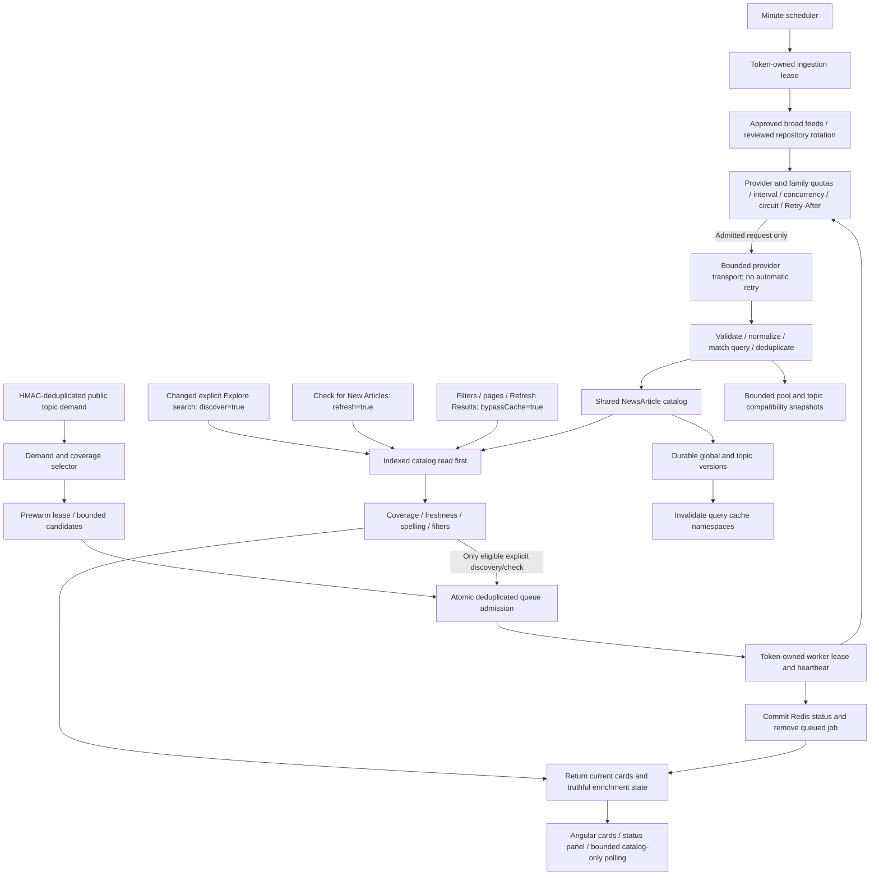
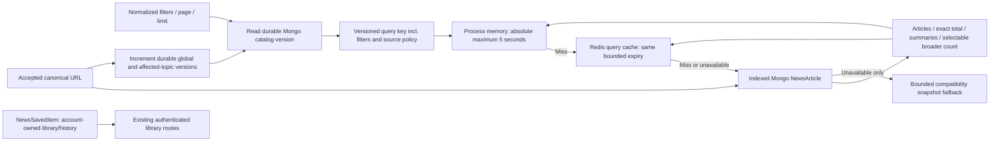
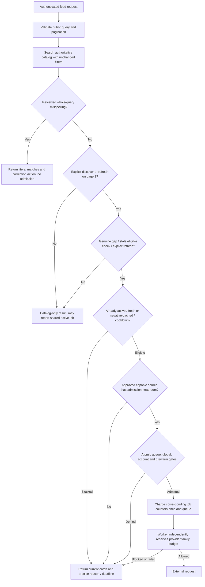
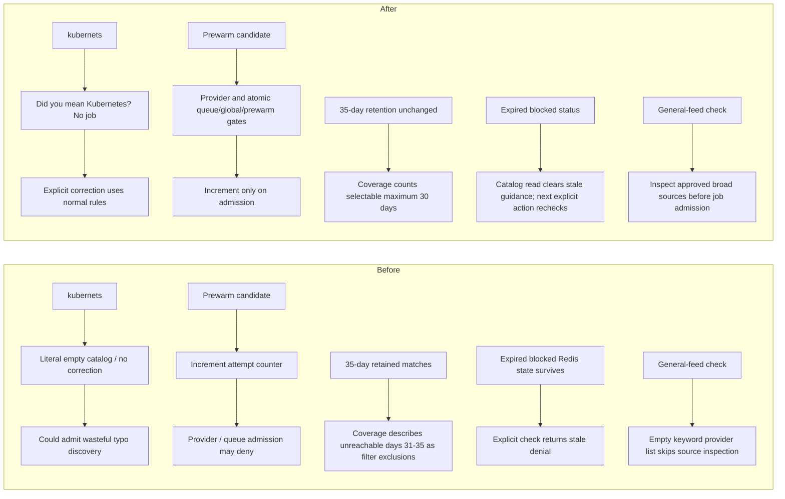

# Tech News flow audit and search reliability

24 October 2026. Scope: configured local application, authenticated API/Angular acceptance, and isolated Redis/Mongo write-sensitive verification. No production deployment was performed.

## Current architecture



Broad ingestion runs without an online user and does not consume the global discovery-job counter. A manual general-feed check does consume one admitted discovery job and then enters the same broad-ingestion lease. Both paths compete for the same provider budgets. Adaptive work and user topic discovery share the worker queue and global jobs; prewarming has additional restrictions.

For You reads the same catalog, resolves canonical Developer Context and applies the existing 50/30/20 ranker and evidence. Hidden search/category parameters are ignored there. Explore uses independent explicit interests, catalog totals and server pagination; it does not resolve career signals. Date/source filters remain effective. Saved/bookmark/read-later/history collections and ownership logic are unchanged.

The adaptive selector defaults to three distinct accounts over seven days, six target articles, a six-hour stale-coverage threshold and at most two candidates per evaluation. Prewarming evaluates at most hourly by default and skips a topic snapshot with six articles checked within the last hour. Repeated searches from one account do not add distinct demand; HMAC tokens and the eight-topic daily contribution cap preserve account isolation. With `demand-coverage`, observed under-covered/stale catalog topics can supply bounded fallback candidates; `demand-only` disables that fallback. No raw private profile or arbitrary query is used as an upstream prewarm topic.

## Storage and cache flow



Mongo stores canonical URL identity, article metadata, multi-technology tags, indexed search terms and absolute expiry. The eight existing indexes, including unique canonical identity, TTL, technology/date and search-term/date indexes, remain unchanged. Retention remains source-aware and capped at 35 days. HN/DEV search and broad policy restrictions both apply. Cache reads check the durable version before returning a memory/Redis candidate, so another worker's successful ingestion becomes visible without a restart. Ordinary catalog revalidation does not extend article retention.

## Actual request and external-call decisions



Filtering, pagination and Refresh Results are catalog-only, including when quotas are exhausted. An empty changed search does not request discovery. An explicit Check for New Articles with an empty search intentionally checks the general feed; it is not a keyword search. Unsupported public syntax is rejected by middleware before service/admission. The service also guards unsupported internal calls. Arbitrary valid technical free text remains supported through bounded keyword groups; unrelated AWS/S3 news is not treated as an exact EC2 match.

Keyword discovery supports approved searchable sources; fixed repository/RSS sources are eligible for broad ingestion or reviewed topic adapters, not arbitrary keyword transport. A general-feed manual check now inspects approved broad sources rather than the empty keyword-provider list. All worker requests still require provider reservation, even after job admission. A provider can become blocked between inspection and execution; an already admitted job legitimately remains charged. Job admission is not a promise of a successful article or provider call.

## Refresh, timers and before/after corrections

```mermaid
sequenceDiagram
  participant U as Reader
  participant A as Angular
  participant B as Backend
  participant C as Shared catalog
  participant W as Governed worker
  U->>A: Refresh Results / change filter / change page
  A->>B: bypassCache=true (no discover/refresh)
  B->>C: Indexed filtered read
  C-->>A: Current cards, exact totals, state, serverTime
  U->>A: Changed search / Check for New Articles
  A->>B: discover=true / refresh=true, page 1
  B->>C: Read existing cards first
  B-->>A: Cards and suggestion / admitted state / blocking reason
  opt Actually admitted and provider-eligible job
    B->>W: Shared deduplicated queue
    W->>C: Persist accepted articles and bump versions
    A->>B: Up to four existing 20-second catalog-only polls
    B->>C: Read updated version
    C-->>A: New cards and totals without restart
  end
  Note over A: Spinner only for active queued/searching/processing during bounded checks
  Note over A,B: Deadline derived from server time; expiry enables explicit eligibility recheck, never an automatic provider retry
```



Corrections are a small reviewed whole-query map (`kubernets`, `kubernates`, `dockr`, `terrafom`), validated against existing taxonomy identifiers. There is no unrestricted fuzzy matching. Suggestions never rewrite the query or return corrected articles as literal matches. Both explicit search and manual check avoid a job for these spellings. Clicking the suggestion retains selected filters and submits the normal corrected search.

Prewarm accounting was reproduced against committed source loaded in memory: two provider-denied candidates produced counter `2` instead of no counter. The corrected Redis Lua transaction performs the prewarm limit check and increment alongside actual queue/global/account admission. Duplicate, occupied-queue, source-denied, reserved-capacity and daily-cap denials do not increment it. The operator audit field is now `prewarmAdmittedJobs` rather than `prewarmAttemptCounter`. Existing counters are never reset or retrospectively rewritten.

Expired non-success Redis states previously failed the “successful previous state” admission condition and could keep denying until key expiry. The service and Lua transaction now disregard an expired blocking deadline while always respecting genuinely active jobs. UTC daily/account and minute-boundary denial deadlines are constructed from exact boundaries, avoiding millisecond drift from repeated clock reads. Angular explains elapsed limits, enables an explicit check after the countdown, and performs no automatic source retry.

Publication timestamps were also incorrectly used as catalog freshness and discovery-attempt timestamps. A new regression with six freshly ingested two-day-old articles and an older topic snapshot reproduced one unnecessary stale-job admission. The corrected service uses the later of actual topic-check time and catalog ingestion/update time for admission and freshness labels. Publication time still exclusively controls article date eligibility. The regression now returns six articles, fresh telemetry and zero jobs. This prevents an older topic snapshot from hiding fresh shared-catalog coverage.

## Authenticated runtime search evidence

All twelve week/month requests returned HTTP 200. See [before](backend/verification/tech-news/flow-audit/api-before.json), [initial corrections](backend/verification/tech-news/flow-audit/api-after-corrections.json) and [final after](backend/verification/tech-news/flow-audit/api-after.json) for titles, source attribution, normalized queries, indexes, coverage, enrichment and server timestamps.

| Search        | Week before → after | Month before → after | Finding                                                                         |
| ------------- | ------------------- | -------------------- | ------------------------------------------------------------------------------- |
| kubernets     | 0 → 0               | 0 → 0                | Literal query retained; now offers Kubernetes correction and no job             |
| kubernetes    | 1 → 1               | 1 → 1                | Correct eligible catalog match                                                  |
| k8s           | 1 → 1               | 1 → 1                | Existing alias correctly normalizes to Kubernetes                               |
| devops        | 31 → 58             | 37 → 64              | Existing multi-tag search works; a governed real job added 27 accepted articles |
| EC2           | 0 → 0               | 0 → 0                | No retained literal EC2 article; not an alias/index failure                     |
| generative ai | 1 → 1               | 1 → 1                | Both keyword groups required; no broad AI substitution                          |

The catalog grew from 366 to 370 during normal configured broad ingestion, then to 397 after one actual governed local DevOps job. That job returned six HN and 27 DEV items, inserted 27 new accepted articles and consumed one global job plus one request from each search provider. It appeared during the initial browser reproduction, before the final freshness correction. No paid provider was called and no article was fabricated. Subsequent browser reads adopted 58 weekly/64 monthly DevOps results without a backend restart for ingestion.

The final index audit found five retained Kubernetes text matches and 68 DevOps matches, with zero missing expected technology tags/search terms. Only one Kubernetes and 64 DevOps records are within selectable dates. Before the new ingestion, broader counts of 5 and 41 incorrectly included days 31–35; the initial corrections snapshot shows corrected counts of 1 and 37 with identical article totals. Final broader counts are 1 and 64. Thus week/month Kubernetes no longer claims four removable filter exclusions, and monthly DevOps no longer claims four nonexistent filter exclusions. No taxonomy migration, reindex or backfill was necessary.

The real browser check uses a deliberately selected fixed-feed source for correction acceptance, so the corrected keyword cannot admit external discovery. It also verifies DevOps search, date changes, pagination, Refresh Results and For You. Separate isolated authenticated HTTP checks verify correction with All sources, a legitimate gap, provider execution, ingestion and exhausted-quota catalog results. The initial real governed job above is explicitly counted; the final browser run separately records global/prewarm/HN-search/DEV-search counter snapshots.

The final read-only API audit (09:01:53 UTC) observed global usage 1/12, no prewarm counter (zero admitted today), a live worker heartbeat approximately 971 ms old, and unchanged job/provider counters around all twelve reads. The first diagnostic helper used an unsupported timeout value, which fell back to the cache's 150 ms default; its missing diagnostics were not proof of a Redis outage. The helper now uses the supported 1500 ms diagnostic timeout and `probeOnly` initialization. Earlier helper initialization used the standard cache initializer, whose existing ready handler rotates an Interview cache revision; no News quotas or article/library data were reset. The corrected helper performs no such revision write.

## Quotas, reset and capacity

Configured values remain global **12 jobs/UTC day**, account **3/minute and 6/UTC day**, adaptive **4/UTC day**, and **6 reserved user slots**. The prewarm strategy remains `demand-coverage`. Day keys use UTC dates and expire at the next UTC midnight (05:00 Asia/Karachi); month keys and provider limits remain governed independently. Account minute keys use UTC epoch-minute buckets. Reset does not initiate discovery.

The reserved-six rule rejects prewarm once total jobs reach six. It guarantees prewarming cannot use the last six global slots; it does not promise each reader six slots or prevent other users consuming them. If four prewarms run before users, eight of twelve jobs remain for user work. If users spend six first, prewarming stops even if its own four-job allowance remains. Duplicate shared searches, spelling suggestions, catalog-only reads and pre-admission denials cost zero jobs.

| Provider at recorded after-audit             | Daily used / effective limit | Actual admission                           |
| -------------------------------------------- | ---------------------------- | ------------------------------------------ |
| Hacker News broad / DEV broad                | 6/72 each                    | Allowed at final observation               |
| HN search / DEV search                       | 1/12 each                    | Allowed at final observation               |
| GitHub releases                              | 6/6                          | UTC daily limit, next 25 October 00:00 UTC |
| GitHub advisories                            | 5/6                          | Interval until 09:08:38 UTC                |
| Kubernetes Blog                              | 4/4                          | UTC daily limit, next 25 October 00:00 UTC |
| NewsAPI, GNews, Reddit, Lobsters, Cloudflare | 0/0 effective                | Disabled by approval/budget configuration  |

These are time-stamped observations, not permanent provider failures. Configured credentials alone do not activate a provider or establish its upstream entitlement. Search and broad adapters share their upstream-family budgets, intervals and cooldowns; adaptive execution additionally receives only the first half of provider/family ceilings. HN/DEV searches each permit 12 daily requests and 300 monthly requests; two-source jobs can consume both. Jobs and provider requests are different counters, and an external error/empty result can still consume an admitted provider request. Worker execution is bounded to at most four provider attempts per job.

Twelve global jobs/day cannot be certified as adequate without production demand data. It allows at most twelve distinct admitted cold/stale/manual jobs across all accounts, not twelve page reads. With four prewarms, only eight user jobs remain; two users using six unique jobs each already exceed that remaining capacity. Shared topic deduplication, catalog retention and broad ingestion reduce demand, but do not establish a traffic forecast. Before changing limits, measure unique eligible gaps, denial rates, prewarm yield, accepted articles/job and provider/family headroom. Operator options within existing settings are demand-only prewarming, a lower prewarm allowance, more reserved user slots, or a reviewed global setting within its existing 1–48 bound. Increasing job budgets requires confirmed upstream daily/monthly entitlements and capacity modelling; no budgets were increased here.

## Verification and finalization

Monthly headroom is also material: 12 two-source jobs daily over 30 days would require 360 requests from each search provider, exceeding each configured 300/month ceiling. At that mix the monthly ceiling supports roughly ten jobs/day on average, even before other family usage. Actual source fan-out and prewarm yield must inform any capacity adjustment.

Focused verification includes 37 backend tests with no skips, the two affected Angular specs, TypeScript, build, syntax checks, formatting write/check and Git whitespace validation. No repository-wide suite was run. The isolated authenticated HTTP test serves 14 stored matches while the fixture global budget is 12/12; typo correction and six sufficient Kubernetes/alias matches add zero provider requests/jobs. The original prewarm defect and the publication-age defect were each reproduced as failing regressions before verifying their corrections. UTC reset, duplicate charging, prewarm reservations, real provider cooldown propagation, shared budgets, multi-tag indexes, cross-worker publication and saved/history ownership are covered.

See [validation evidence](backend/verification/tech-news/flow-audit/validation.json), [cleanup evidence](backend/verification/tech-news/flow-audit/cleanup.json), and [authenticated browser evidence](frontend/verification/tech-news/flow-audit/after.json). Essential screenshots are [suggestion](frontend/verification/tech-news/flow-audit/suggestion.png), [Explore](frontend/verification/tech-news/flow-audit/explore.png) and [For You](frontend/verification/tech-news/flow-audit/after.png).

One restricted Angular test run could not start Vitest fork workers; the same focused command passed outside that restriction. The first browser attempts had ambiguous test locators, subsequently narrowed to the discovery panel/header. A build overlapped concurrent stylesheet writes and caught incomplete Sass; the completed workspace build passed. The existing unrelated landing-page SCSS warning remains (55.89 kB versus a 48 kB budget). No upstream entitlement or production deployment is inferred from local success.

Final results: **37 backend tests and 57 Angular tests passed**, plus four post-cleanup focused regressions, TypeScript, build, ten JavaScript syntax checks and explicit formatting checks. The final authenticated browser scenario inspected nine feed responses with zero page errors; its global/prewarm/HN-search/DEV-search counters remained **[1, 0, 1, 1] → [1, 0, 1, 1]**. Full-page screenshots were retained after visually checking that element captures clipped surrounding layout. The harness now matches the corrected search response explicitly so an overlapping catalog-only focus revalidation cannot be mistaken for the correction response. A transient native Redis disconnect during an earlier capture did not prevent Mongo catalog browsing; the final healthy counter snapshot is recorded separately. Stable production Redis connectivity remains an operator gate.

### Exact task-owned source/document inventory

All paths below are relative to `D:/Developer-Portfolio-Analyzer/`:

- Added `TECH-NEWS-FLOW-AUDIT.md`.
- Added `backend/src/scripts/verifyNewsFlow.js`.
- Added `backend/src/tests/newsFlow.test.js` and `backend/src/tests/newsFlow.integration.test.js`.
- Changed `backend/src/scripts/auditNewsRuntime.js` (admitted-counter field name).
- Changed `backend/src/services/newsCatalogService.js` (selectable broader date bound).
- Changed `backend/src/services/newsDiscoveryService.js` (suggestion/invalid-query guard, atomic prewarm accounting, exact deadlines, expired-state and broad-source admission).
- Changed `backend/src/services/newsService.js` (ingestion/check freshness rather than publication age).
- Changed `backend/src/utils/newsQuery.js` (reviewed suggestions).
- Changed `backend/src/tests/newsFreeText.integration.test.js` (authenticated quota/catalog/correction regressions).
- Changed `frontend/scripts/verify-news-search.cjs` (focused flow-audit mode, bounded diagnostic counter snapshots and scoped locators).
- Changed `frontend/src/app/pages/news/news.component.ts`, `news.component.html` and `news.component.spec.ts` (suggestion action, elapsed-limit feedback and regressions).
- Changed `frontend/src/app/shared/models/news.model.ts` (optional backward-compatible suggestion contract).

### Evidence, moves, deletion and concurrent work

- Added `backend/verification/tech-news/flow-audit/api-before.json`, `api-after-corrections.json`, `api-after.json`, `validation.json` and `cleanup.json`.
- Added `frontend/verification/tech-news/flow-audit/after.json`, `suggestion.png`, `explore.png` and `after.png`.
- Moved this task's initial `api-after.json` to `api-after-corrections.json` before writing the final runtime snapshot; both phases are essential evidence. No source files were moved or deleted.
- Removed only the verified task-owned `/tmp/devinsight-flow-IeMOKA` WSL Redis source/build directory after asserting zero database keys and stopping its server on port 27144. The final isolated batch removed 195 namespaced Redis keys and dropped its four temporary Mongo databases through fixture teardown. No application counter was reset and no historical/user artifact was deleted.
- Concurrent work appeared after the initial clean Git status in `frontend/src/app/pages/news/news.component.scss`, `frontend/src/app/shared/components/news-card/news-card.scss`, `frontend/src/app/shared/components/news-filters/news-filters.html` and `frontend/src/app/shared/components/news-filters/news-filters.scss`. Those edits are preserved and are not claimed as this task's changes. Concurrent layout edits in the shared `news.component.html` were also preserved; its combined markup was formatted because this task adds the suggestion button there.
- No credential, environment assignment, provider approval, quota, index, infrastructure, ranker, saved/history module or locked-module source was changed. The existing local backend remains running with final News changes.

### Remaining production gates

Confirm documented provider/Redis entitlements, attribution/retention requirements and operator approvals for intended traffic; disabled sources remain disabled. Validate deployed indexes, durable shared Redis/worker heartbeat, production monitoring/alerts, latency and real traffic capacity. Perform deployment acceptance in the production environment separately. EC2 has no stored literal matches, so additional eligible discovery is needed to populate that query; unrelated AWS articles are deliberately excluded. Twelve global jobs/day is a configured limit, not a production capacity certification.

STATUS: VERIFIED — local implementation and controlled acceptance

CURRENT FLOW VISUALIZED: YES

SEARCH & TYPO HANDLING VERIFIED: YES

CATALOG-FIRST RESULTS VERIFIED: YES

QUOTA & RESET HANDLING VERIFIED: YES

READY TO LOCK LOCAL IMPLEMENTATION: YES

READY FOR PRODUCTION DEPLOYMENT: NO
