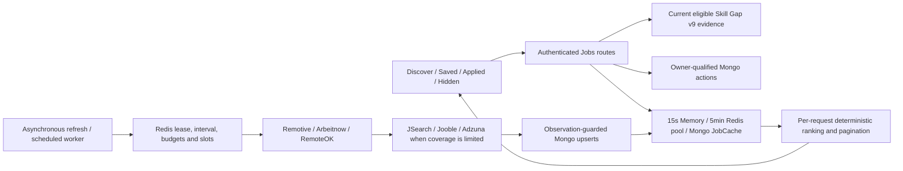

# Jobs Hub production finalization — 8 November 2026

**Status: PASS for the executed local checks; BLOCKED for production acceptance.** Live provider rights/entitlements, deployment index inventory, regional Redis latency and representative staging capacity remain external gates. No provider API request, production-data operation, commit, push, merge or deployment was performed.

## Authorization and scope

The user explicitly authorized continuing on `fix/finalize-public-portfolio`; its verified starting HEAD was `7cbacf47496517788e0ab79ac7bf19df646c39ae`. No PR integration was requested; target is not applicable. Three pre-existing **staged** Portfolio settings files (`.html`, `.scss`, `.ts`) were preserved and excluded from formatting and edits. This task's changes remain unstaged.

Read root AGENTS.md, the actual Jobs frontend/backend, relevant source/evidence consumers, environment names/configuration, and the three existing Jobs reports. No API route, response schema, Mongo model schema/index, job-ID algorithm, history retention rule, ranking weight, provider count, Redis Lua script or shared infrastructure architecture changed. Recruiter Hub, Learning Hub, Skill Gap, Career Sprint and Dashboard source files were not modified. The whole repository regression suite was not run.

## Current architecture and contracts

- `GET /api/jobs`, `/:id`, `/source-health`, `/cache-health`, `/actions`, `PUT /:id/actions` and the existing POST/DELETE save/apply/hide aliases remain unchanged. JWT protection and request validation precede route handlers; personalized responses are private/no-store.
- Active developer context wins over query-supplied stack/experience. Current source compatibility is checked before personalized ranking. `resolveSkillSignals` supplies only DEMONSTRATED skills as known skills. UNKNOWN is neither demonstrated nor converted into a negative evidence classification. PARTIAL/CLAIMED_ONLY/NOT_EVIDENCED can inform learning priorities, not claimed proficiency. Incompatible/missing evidence produces career-context-only results.
- The shared pool contains public source listings, never personalized actions or scores. Filtering/deduplication/ranking occur per request. Hidden records are removed before slicing pages. The pool is intentionally capped at 1,000 candidates: totals and pagination are for that candidate set, not the entire internet or all historical Mongo rows.
- Job IDs and canonical external-ID alias resolution are preserved. Actions use deterministic owner/job primary keys and an owner/job unique index. Atomic field patches are idempotent; duplicate upserts retry an owner-qualified update. Existing history survives cache expiry and remains editable; new actions require an available retained listing. Action history has no TTL.
- Detail retrieval checks current provider/retention expiry and hidden state. Save/Applied/Hide are personal records. Opening a source link does not submit an application or mark it applied.
- Browser cache remains 30 seconds/20 entries, owner and active-context scoped, with cancellation, cloning and invalidation. Views reconcile on opening, focus after 30 seconds, reconnect and manual recheck. History hydration remains bounded to three concurrent detail requests. Sorting remains page-local.

## Confirmed defects and minimal fixes

| Finding                                                                                  | Implemented correction                                                                                                                                                       | Evidence                                                                                                                                                     |
| ---------------------------------------------------------------------------------------- | ---------------------------------------------------------------------------------------------------------------------------------------------------------------------------- | ------------------------------------------------------------------------------------------------------------------------------------------------------------ |
| Stack coverage divided by `keywordCount * 0.28`, then applied the 0.28 weight again      | Normalize hits by the full keyword count; retain 28/42/20/10 weights                                                                                                         | Three Full Stack keywords out of eleven now produce 27% stack coverage rather than 97%; pinned composite result 46 instead of 65 under the specified fixture |
| Unsupported stack names silently borrowed Full Stack keywords                            | Give no stack-keyword credit when no stack policy exists; keep skill/experience/recency scoring                                                                              | DevOps fixture cannot receive a false Full Stack-derived alignment explanation; no new taxonomy invented                                                     |
| Equal scores retained provider/input order, which could change pagination                | Stable existing-ID tie-break using code-unit comparison                                                                                                                      | Same order for forward/reversed equal-score inputs                                                                                                           |
| Date.now was sampled separately per job                                                  | Use one recency observation per ranking pass                                                                                                                                 | Identical jobs at the three-day boundary receive identical scores                                                                                            |
| An absent job experience level could still produce “Close fit” copy                      | Emit that explanation only for a recognized supplied experience label                                                                                                        | Missing experience remains numerically bounded without a false fit claim                                                                                     |
| A slow Mongo fill could return obsolete data despite newer local memory                  | Return the selected winning memory payload                                                                                                                                   | The waiting caller and subsequent reads both receive the newer payload                                                                                       |
| A worker rejected by Redis publication still returned/cached its own obsolete payload    | Read and adopt the valid newer shared envelope after Lua rejection; retain its absolute expiry                                                                               | Unit and actual Redis checks verify both returned data and the losing worker's subsequent memory hit                                                         |
| A delayed worker could overwrite newer Mongo observations after its lease elapsed        | Capture refresh observation time before ingestion, atomically retain newer `lastSynced` rows using an update pipeline, and propagate that observation into Redis publication | Real Mongo asserts stale content, updatedAt and createdAt cannot replace the newer row; no schema/version field added                                        |
| Summary claimed gaps were used by the ranking formula although they only inform learning | Describe them as learning priorities from current evidence                                                                                                                   | Public field/shape unchanged; known-skill union unchanged                                                                                                    |
| Source names were plain text despite provider backlink requirements                      | Link attribution to a fixed allowlist of official provider sites, preserve outbound safety; meet Adzuna label dimensions                                                     | Unit URL tests and browser href, rel, focus and 116×23 minimum-size assertions                                                                               |
| Page-local sorting was visually described only as “Sort by”                              | Clarify visible and accessible label to “Sort this page”                                                                                                                     | Existing sorting implementation/pagination retained                                                                                                          |

The Mongo guard orders **existing observation timestamps**, not provider publication versions or a new globally monotonic fencing counter. Workers still require synchronized clocks. The existing Redis lease/token release, Lua publication comparison and provider admission remain intact; equal observation times are ties, and no stronger cross-clock exactly-once guarantee is claimed.

### Ranking formulas verified

The composite remains `round(0.28 × stack + 0.42 × skill + 0.20 × experience + 0.10 × recency)`, clamped to 0–100; `score = matchScore / 100`. Stack coverage is rounded keyword coverage. Skill matching retains aliases/token boundaries and capped overlap; missing known evidence uses the existing heuristic baseline of 35. Experience distance retains 100/78/55/28 and existing label defaults. Recency retains 100/84/66/48/24 at 3/7/14/30-day cutoffs, with 35 for missing dates.

These are discovery heuristics, not calibrated qualification probabilities, readiness scores or verified proficiency. The four explicit stack-keyword policies remain Full Stack, Frontend, Backend and AI/ML; other stacks can still match through recorded skills/experience but receive no invented stack-policy credit. No scoring state or historical record is rewritten.

## Provider, licensing and environment review

Exactly six adapters remain. Free public sources are requested first, in parallel. Metered providers are considered when the free batch has fewer than 80 rows or a source filter explicitly selects them. Admission still controls every actual transport request. Missing/placeholder credentials are skipped. Remotive remains explicit opt-in. No provider credential was tested against a live API; presence is not validity or entitlement.

| Provider  | Access/configuration                                          | Existing admission default                               | Coverage and release requirement                                                                                                                                                                                                                                                                                                                 |
| --------- | ------------------------------------------------------------- | -------------------------------------------------------- | ------------------------------------------------------------------------------------------------------------------------------------------------------------------------------------------------------------------------------------------------------------------------------------------------------------------------------------------------ |
| Remotive  | `JOB_REMOTIVE_ENABLED=true`; no public API key                | 4/day, 1,000/month, one slot, at least six-hour interval | Public API is delayed and requires source/original-link attribution; its signup-gated redistribution restrictions require explicit product/permission review before enabling this authenticated hub. [Official API terms](https://github.com/remotive-com/remote-jobs-api/blob/main/README.md)                                                   |
| Arbeitnow | Public endpoint; no key                                       | 24/day, 1,000/month, one slot, hourly interval           | One bounded response, not exhaustive regional/paginated coverage; backlink required, access revocable. [Official terms](https://www.arbeitnow.com/terms)                                                                                                                                                                                         |
| RemoteOK  | Public feed; no key                                           | 24/day, 1,000/month, one slot, hourly interval           | Bounded feed; retain original job URL and credit/link back. [Official feed guidance](https://remoteok.com/faq)                                                                                                                                                                                                                                   |
| JSearch   | `RAPIDAPI_KEY` or existing settings credential                | Daily/monthly defaults **zero** until opted in; one slot | Actual marketplace subscription and remaining requests/overages must be confirmed. Public free-tier availability does not prove this account's plan. [Provider documentation](https://www.openwebninja.com/api/jsearch)                                                                                                                          |
| Jooble    | `JOOBLE_API_KEY`                                              | Daily/monthly defaults **zero**; one slot                | Fixed jooble.org adapter is region-scoped; keys from other country domains are not interchangeable. Confirm permitted region and actual remaining entitlement. [Official regional-key guidance](https://help.jooble.org/en/support/solutions/articles/60000922689-how-to-connect-to-the-jooble-rest-api-after-receiving-the-key)                 |
| Adzuna    | `ADZUNA_APP_ID`, `ADZUNA_APP_KEY`, supported `ADZUNA_COUNTRY` | Daily/monthly defaults **zero**; one slot                | Commercial use/attribution require account/license review. Current local `ADZUNA_COUNTRY` is `eu`, unsupported by this adapter and therefore falls back to `us`; the operator must select an intended supported country before staging. No country choice was invented. [Official API terms](https://developer.adzuna.com/docs/terms_of_service) |

All credential values, including application identifiers, are excluded from the retained environment inventory. `environment-audit.json` contains 43 relevant runtime/template names, presence flags and safe noncredential settings. `.env` and `.env.example` were not modified. The three metered credential groups are present locally but **not live-verified**; their budget defaults remain disabled. No paid allowance was invented or consumed.

Policy keys are `JOB_<JSEARCH|JOOBLE|ADZUNA|REMOTIVE|ARBEITNOW|REMOTEOK>_<DAILY_BUDGET|MONTHLY_BUDGET|CONCURRENCY|MIN_INTERVAL_MS>`. Missing policy entries use existing code defaults; explicitly configure budgets below actual remaining account quotas before enabling metered calls. UTC day/month resets do not establish a provider's billing or lifetime entitlement. `JSEARCH_RETRIES` is present in the environment but not consumed by the current dedicated transport; it does not create retries.

Unrelated duplicate names were detected and **left untouched**: actual environment `COURSES_SPRINT_RATE_LIMIT_MAX`, `SUPPORT_INBOX_EMAIL`; example environment includes duplicate course cache/rate-limit names listed in the JSON inventory. These belong to finished modules and are separate configuration housekeeping, not Jobs changes.

## Cache, rate limits, concurrency and recovery

- Mongo freshness is 36 hours by current configuration (allowed range 24–48); retention defaults to seven days, minimum three. Provider validThrough and retention expiry override freshness. TTL configuration is verified without claiming synchronous TTL-monitor deletion.
- The public Memory cache lasts 15 seconds; Redis pool envelope has five-minute absolute expiry. Promotion does not extend expiry. Mongo is the durable fallback; emergency stale memory is bounded and callers still validate listing expiry. Source revisions are not owner-specific because the pool contains public data only.
- Public pool rebuilds are locally deduplicated. Refresh uses the existing 60-second Redis lease and interval gate. Source admission uses atomic Lua daily/monthly reservations, cooldown and sorted-set concurrency slots. Uncertain reservations are not refunded; a failed transport might have consumed quota.
- Transport remains one bounded attempt: at most six seconds HTTP timeout, seven-second abort signal, no redirects, 5 MiB response cap and 64 KiB request cap. Errors with URLs/headers/provider bodies are sanitized. No request multiplies paid calls through retries.
- Shared user limits remain 120 reads/minute, two explicit refreshes/15 minutes, 30 mutations/minute. Redis outage makes mutations/explicit refresh fail closed with 503; reads retain the existing bounded **per-process** limiter and Mongo/cache fallback. Do not describe this outage read allowance as a distributed limit.
- Actual Redis suites verify 429/cooldown recovery, exhausted budgets, three-failure circuit, UTC/interval/slot TTLs, token-owned release, shared limits, crash/lease recovery, absolute expiry, failed connection behavior, and competing child workers. The two-worker upstream callback is synthetic: it proves coordination, not a live provider call.

### Actual Mongo query plans and local measurements

The real disposable fixture contains 2,000 synthetic current jobs plus expiry/history cases. Existing indexes were retained; no demonstrated query inefficiency justified a new index.

| Observation                              | Result                                                                                      |
| ---------------------------------------- | ------------------------------------------------------------------------------------------- |
| Public pool sort/cap                     | 1,000 returned, 1,000 keys and documents examined; indexed deterministic cache-order scan   |
| Canonical/external-ID detail predicate   | One returned; indexed OR branches from existing identity indexes                            |
| Owner history predicate                  | One owned row returned using existing owner/history indexes                                 |
| Concurrent same-owner upserts            | 15 callers, one action record; other owner's flags isolated                                 |
| Initial 1,000-job cold cache module read | 209.162 ms                                                                                  |
| Final publication-fix cold read          | 418.451 ms                                                                                  |
| Initial warm p50 / p95, 20 memory reads  | 13.716 / 18.744 ms                                                                          |
| Final warm p50 / p95                     | 15.891 / 20.735 ms                                                                          |
| Public-cache observations                | One Mongo load across 22 reads, including another cache instance; 21/22 cache hits (95.45%) |

Full plans and timings are retained in `real-integrations.log` diagnostics. These local measurements include cloning a 1,000-job payload and relevant cache I/O; they are not HTTP latency, provider latency, production hit rates or acceptance SLOs. Representative expired/hidden-heavy catalogs and large owner histories still require staging plans/load tests.

## Frontend and cross-module compatibility

All four views, current layout, themes, responsive cards/filters, pagination, safe source navigation and history handling remain. Changed UI text/links address verified truthfulness and attribution only. No external link marks an application or changes account activity. Keyboard source-link focus and meaningful href/rel checks accompany desktop/mobile Light/Dark overflow checks. This is basic accessibility verification, not a complete WCAG certification.

Learning Hub course suggestions remain read-side, owner-derived hints. Sprint suggestions read existing owner tasks and navigate to the existing Sprint view; no task creation/completion or XP policy changes. Legacy recommendation/Sprint hints are not promoted into known skills or current Skill Gap evidence. They are existing owner hints, not a newly certified snapshot-freshness contract. Recruiter Hub uses its separate job model/service/card implementation; no recruiter data or ownership rule was unified with external Jobs Hub listings. Dashboard readiness semantics remain covered by the existing consumer tests; Jobs actions do not award readiness or proficiency.

## Historical evidence correction

The older `backend/verification/jobs-hub/final-e2e/final-report.md` labels its run as real Redis/Upstash E2E. Actual `verifyJobsHubFinalE2E.js` replaces `getRedisCacheClient` with an in-process map whose eval increments a counter; its default Mongo target and historic output paths also require care. That run does **not** prove real Lua, Redis failure behavior or production readiness. It was not rerun against any application service. The earlier dedicated Redis report has separate real-service evidence; it is retained as history, not evidence of today's deployment.

This task instead ran actual Lua against isolated local Redis, actual disposable Mongo queries/updates, separate child workers, and a new real HTTP/JWT test. Browser journeys use intercepted synthetic API contracts; neither browser fixtures nor the upstream callback are counted as production provider acceptance.

## Exact test runs and retained failures

Exact commands, exit codes and child wall times are in each timestamped run's `results.json`. Test logs retain names, timings and available stacks. No full repository regression was run.

- Before fixes: `node --test backend/src/tests/jobsHubRanking.test.js backend/src/tests/jobsHubHardening.test.js`: **23 pass / 4 fail / 0 skipped**. `before-fixes.tap` retains the default reporter and stacks for stack normalization, tie ordering, recency boundary and stale-fill return.
- Initial focused post-fix Jobs tests: **27/27** in `after-fixes.tap`, 6,649.0759 ms TAP duration.
- `run-2026-11-08T12-14-46-438Z`: **61/61** focused Jobs/context/Skill Gap consumer/course contracts; **9/9** actual Redis/Mongo tests. Runner then stopped at an over-strict Windows TCP relay cleanup check; Redis had already stopped. Failure is retained and the check now probes Redis itself.
- `run-2026-11-08T12-22-10-612Z`: **1/1** new real HTTP integration, zero skipped, 12,592.2654 ms TAP / 12,913 ms wall. Real JWT and route middleware, two local HTTP servers, actual Mongo/Redis, 15 concurrent mutations, hidden-before-page behavior, other-owner isolation, expired retained history, fail-closed action outage/recovery, zero provider calls. The Learning Hub boundary returns fixture recommendations; no live Learning Hub acceptance is implied.
- `run-2026-11-08T12-22-36-448Z`: npm tests/build failed before execution with **ENOSPC** on C:. Logs retained; unrelated user files were not deleted. Only task npm cache/TEMP paths were redirected to D:.
- `run-2026-11-08T12-27-21-016Z`: build passed; Angular **26 pass / 1 fail**. The test selected the first external anchor, now the source-attribution link, instead of the application action. It now selects `.btn-apply-primary` and still checks target URL/rel and no mutation. Browser launcher lacked its downloaded Chromium shell; no package/browser was installed. The verifier now uses installed Edge.
- `run-2026-11-08T12-33-47-289Z`: Angular **27/27**, zero skipped, reported 21.86 s; TypeScript exit 0; production build exit 0, Angular 111.633 s. Existing unrelated Landing Page stylesheet warning remains 56.67 kB against 48 kB. Browser exposed an obsolete `.library` selector, corrected to current `.library-container`; old heading/control selectors were aligned to current UI without changing its design.
- `run-2026-11-08T12-35-59-828Z`: focused backend **63/63** before the final absent-experience explanation test; actual Redis/Mongo **9/9**, zero skipped, 27,633.2792 ms TAP / 28,410 ms wall. Includes the losing publisher's returned-payload and subsequent-memory assertions.
- `browser-2026-11-08T12-38-41-836Z`: final browser **17/17** checks, exit 0, 34,133 ms. Synthetic APIs only, external traffic intercepted/blocked. Covers four views, all theme/viewport combinations, search/source/page sorting/pagination, details/external application, source attribution/focus/dimensions, legacy/expired history, 429, 503, offline, loading and empty states.
- Final backend explanation guard and final formatting/syntax/Git checks are recorded in the finalization evidence alongside this report. The new missing-experience case adds one distinct focused test to the 63-test set above.

Final browser screenshots/results are in `frontend/verification/jobs-hub/production-browser-2026-11-08T12-38-41-836Z/`; desktop Light and mobile Dark were visually inspected. Older screenshots/reports were not overwritten. Windows sandbox launch later failed before commands with “native MXC is unavailable”; successful checks used reviewed host execution, not relaxed application safeguards.

## PASS / FAIL / BLOCKED acceptance matrix

| Gate                                                                   | Local result                                     | Production/staging result                                                                                        |
| ---------------------------------------------------------------------- | ------------------------------------------------ | ---------------------------------------------------------------------------------------------------------------- |
| Ranking math, deterministic ordering and truthful explanations         | PASS                                             | Representative product relevance evaluation still required; scores are heuristic                                 |
| Current evidence/owner isolation and unchanged cross-module policies   | PASS focused contracts                           | Real-account cross-device acceptance pending                                                                     |
| Actual Mongo indexes, guarded persistence, Lua, quotas and two workers | PASS; no integration skips                       | Production index inventory, durability/eviction and multi-region latency unverified                              |
| Real HTTP authentication/actions/cache/outage recovery                 | PASS disposable services                         | Production service/deployment acceptance pending                                                                 |
| Angular, TypeScript and production build                               | PASS                                             | Existing unrelated Landing Page stylesheet warning remains                                                       |
| Four-view browser journeys and basic responsive/accessibility checks   | PASS against fixtures                            | Full browser-to-staging-backend acceptance pending; not a live provider test                                     |
| Six-provider parsing/free-first/denial contracts                       | PASS local boundary tests                        | Provider credentials, entitlements, regional coverage and real malformed/error responses BLOCKED/unverified      |
| Source licensing/commercial use                                        | Links corrected locally                          | Remotive opt-in permission/product review and Adzuna license/account compliance BLOCKED; no entitlement inferred |
| Workstation C: capacity                                                | Verification recovered using task-owned D: paths | C: remains full; operator housekeeping outside task scope                                                        |
| Release declaration                                                    | Local fixes verified                             | **BLOCKED** until mandatory external gates are genuinely satisfied                                               |

## Finalization and exact inventory

`file-inventory.json` lists every task-owned changed/new source/report/artifact path, separately from the three preserved staged Portfolio files. No tracked file was moved or deleted. No environment, API, schema, dependency or finished-module implementation changed.

Source changes are confined to Jobs ranking/controller/cache/ingestion, their targeted tests and reusable verifier; Jobs source-attribution presentation/card/details, sort label and tests; and the existing browser verifier. The earlier finalization report receives a current-report pointer while keeping historical text intact.

Scoped Prettier write/check uses the installed frontend executable, frontend configuration for Angular sources, and consistent backend options. Syntax checks cover changed backend JavaScript and both verification scripts. Git working/staged whitespace validation and a final staged inventory are retained. Test-owned database cleanup is checked against disposable database names; Redis cleanup deletes only tracked namespaces and verified task log paths. Task-owned compile caches and temporary browser/npm files are inventoried before individual-file cleanup; diagnostic evidence is retained outside cache directories. No recursive filesystem deletion or destructive Git cleanup is used.

## Final post-cleanup acceptance evidence

- Backend: **64/64**, zero failed/skipped, 7,261.8092 ms TAP / 7,411 ms child wall time. Exact command and log: `post-cleanup-2026-11-08T12-51-31-399Z/`.
- Final frontend source (including inherited-key protection for source-link lookup): **27/27 Angular tests**, zero skips; reported 20.90 s. TypeScript exit 0. Production build exit 0, 99.283 seconds Angular duration. Exact commands, child wall times and logs: `run-2026-11-08T12-56-36-973Z/`.
- Final browser: **17/17**, exit 0, 35831 ms wall time. Six final screenshots and JSON: `frontend/verification/jobs-hub/production-2026-11-08T12-56-36-973Z/`. Earlier passing post-cleanup frontend evidence is also retained in `run-2026-11-08T12-51-48-021Z/`.
- Real integrations remain **9/9** native Redis/Mongo plus **1/1** real HTTP integration, zero skipped. The `jobsHubUpstash` suite filename/parent title mentions TLS; this execution used **loopback Redis TCP**, and does not certify hosted Upstash/TLS.
- Initial task cleanup removed 2,773 disposable files and retained six diagnostic logs. The small final npm/browser temporary files were separately checked and cleaned with diagnostics retained; see `cleanup-results.json` and `post-verification-cleanup.json`. All native fixtures stopped; their owned database/file cleanup and exact namespace deletion evidence remain in each run.
- The initial runner TCP-relay cleanup failure was observed in original command output; a separate raw parent-stderr file was not captured. `runner-observations.json` records that limitation rather than reconstructing a stack. An intermediate unmatched aggregation-expression brace was caught by formatting and corrected before Mongo execution; its original console diagnostic was not retained as a separate log.
- `finalization-results.json` records final scoped formatter checks, syntax checks, branch/status and both Git whitespace checks. The three pre-existing staged Portfolio files remain separate. No production acceptance is inferred from these local results.
