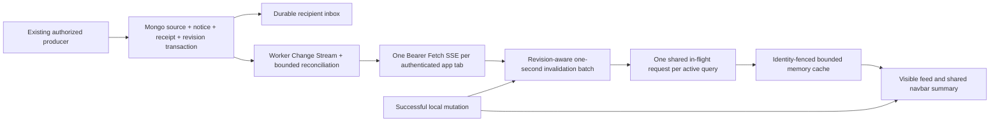
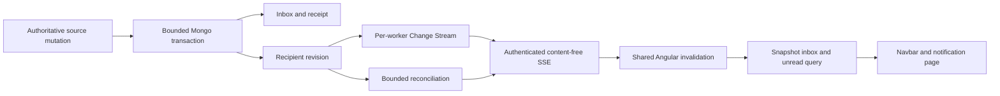

# Notification production finalization

## Current Notifications-only acceptance

Source: existing `task/notifications` at `7d56a1f61dcb4d19b75292b25f4039e74d795c27`; PR target not applicable. The initial working tree and index were clean. This acceptance preserves the committed implementation, tests and evidence, plus concurrent notification UI edits. No Support controller, service, model or ticket workflow was changed. No dependency, API contract, schema, live data, deployment, push or merge is included.

**DEVELOPMENT COMPLETE — STABLE CANDIDATE — PRODUCTION GATES PENDING.** This section supersedes historical acceptance details below for the current task. Historical Help work and its recovery gate belong to the prior implementation and are outside this Notifications-only acceptance.

### Actual browser Network measurements

No screenshot attachment was available in this turn. The measurements use Chrome CDP `Network.requestWillBeSent`, actual initiator stacks, freshly built production bundles, real protected notification routes and disposable Mongo. Unrelated modules/providers use synthetic fixtures. Raw Authorization values, JWTs and notification bodies are excluded from the retained Network trace.

| Controlled scenario                       | Before inbox GETs | After inbox GETs |
| ----------------------------------------- | ----------------: | ---------------: |
| Initial notification page                 |                 4 |                1 |
| Mark one notification read                |                 2 |                1 |
| Five persisted producer events            |                 2 |                1 |
| Reopen preview twice within cache TTL     |                 0 |                0 |
| Initial notification page in a second tab |                 4 |                1 |
| SSE connections per tab                   |                 1 |                1 |

Evidence: `frontend/verification/notifications/network-before.json` and `network-after.json`, including bundle-index hashes, per-tab counts and sanitized compiled-script initiator stacks. Before optimization, the two `limit=5` requests originated from navbar preview loading/stream refresh; the two `limit=10` requests originated from the feed's organization-load/stream paths. Additional mutation callback refreshes overlapped invalidations. SSE itself was already single-connection; it was not the duplicated transport.

### Final architecture and data flow

Navbar and default feed now use the same ten-record first-page query. The navbar displays five records from shared state; it does not fetch its own preview on every feed update. A scoped feed cannot supply a global bell count, so a separate global request remains necessary in that case. Filtered unscoped feeds publish the global unread count while their preview is fetched only when needed.

Invalidations are shared and coalesced for one second before caches are cleared. An active query refetches only its bounded page, not the full inbox. Existing in-flight reads finish before a newer invalidation is reconciled. Duplicate/older SSE revisions and the connected revision already represented by HTTP are ignored. Same-query concurrent requests share one observable; local read state updates immediately without mutating cached objects. Mutation callbacks no longer issue redundant refresh requests. Healthy streams use five-minute reconciliation; unavailable streams retain sixty-second fallback checks and eight bounded reconnect retries with jitter/Retry-After. Logout/session changes clear state and reject stale GET/mutation responses. A late 401 from an old stream cannot log out a newer session.

Inbox startup no longer waits for organization loading or refetches when that request finishes. Feed fixes include complete organization/team filter reset, global/filtered unread rollback, preserved bounded mark-all messages during background refresh, and fallback to an existing page after the last rows are deleted. Obsolete fallback requests are canceled. Failed optimistic reads/deletions undo only their own operation; query/summary versions prevent late failures from replacing newer server state. Navbar mark-all failures also respect a newer summary. The live-status badge is tied to the actual SSE connection signal.

### Producer and recipient verification

The existing non-Support producer contracts were re-read against the preserved matrix and navigation allowlist; no producer was added, removed or refactored:

| Source                      | Verified trigger, recipient and destination                                                                                                                                                                                  |
| --------------------------- | ---------------------------------------------------------------------------------------------------------------------------------------------------------------------------------------------------------------------------- |
| Account/Profile, six events | Successful changed settings, password update/reset, active career selection, avatar exchange and visibility save; current owner; Profile or Career Sprint as appropriate. Password notices remain mandatory security events. |
| Resume, two events          | Committed upload and persisted deterministic analysis; resume owner; Resume Analyzer. Optional AI cannot suppress deterministic completion.                                                                                  |
| GitHub                      | Successful non-stale/non-fallback saved analysis; analysis owner; GitHub Analyzer.                                                                                                                                           |
| Skill Gap                   | Persisted non-preview analysis with at least three gaps; owner and preference gate; Skill Gap.                                                                                                                               |
| Recommendations             | Explicit saved snapshot; owner and recommendation preference; Recommendations.                                                                                                                                               |
| Career Sprint, two events   | Real task-completion transition or eligible streak restore; sprint owner; Career Sprint. Repeated same state remains a no-op.                                                                                                |
| Weekly Reports, two events  | Committed report and recorded unconfirmed email outcome; report owner and weekly preference; Weekly Reports. No new email pipeline is introduced.                                                                            |
| Dashboard                   | Authorized low-readiness projection, daily dedupe; current owner; Dashboard.                                                                                                                                                 |
| Public Portfolio            | Successful publication/settings/reference commit; owner; Portfolio.                                                                                                                                                          |

Stable receipts, source transaction rollback, deleted-event tombstones, preference suppression, current recipient scope and mandatory security notices retain their existing tested behavior. Modules with no existing producer are not represented as newly implemented workflows. Support contracts are preserved and excluded from this task.

### MongoDB, Redis, SSE, privacy and scalability

Mongo remains authoritative for inbox records, receipts, revisions, request windows and shared stream leases. Snapshot feed/count/cursor reads, account/session fences, membership filtering, bounded bulk operations, existing cursor indexes and account-deletion cleanup are unchanged. Redis remains optional acceleration; no new dependency or Redis correctness path was added. The committed disposable two-worker, process-restart, Mongo interruption, Redis independence, expiry/revocation, IDOR and deletion evidence is retained and reused because the underlying production paths are unchanged.

Existing stream bounds remain six/account, 1,000/fleet, 500/worker, sixty-second leases, bounded reconciliation batches and 16 KiB buffering. These are configured ceilings, not verified deployment capacity. Protected requests still enforce Mongo quotas. One-second batching is an upper bound for automatic refresh frequency per active query; user actions and scoped global-count reads remain distinct necessary requests.

Fetch SSE uses Bearer headers, no URL token, no-store semantics, session/expiry checks, abort/reader cleanup and monotonically increasing revisions. Caches remain in memory, limited to fifty entries with a fifteen-second TTL and identity/session fencing. Internal destinations are allowlisted and Angular interpolation retains escaping.

A narrow shared logging fix now strips query strings from notification request and audit route fields, including mixed-case, trailing-slash and mounted-router paths. This prevents private search terms and rejected URL credentials from entering those log fields. Other modules' route representation is unchanged. Structured audit payload masking remains in place. Nine focused tests cover this boundary.

### Verification and exact inventory

See `acceptance-results.json` for current commands, results, exact task-owned changes, concurrent UI paths, retained evidence hashes and cleanup inventory. The existing `integration-results.json`, `governance-regression.json` and `finalization.json` remain historical reusable evidence; they were not overwritten. Fresh checks include the focused notification/navbar/component tests, logging security tests, TypeScript, production build, CDP Network comparison, real-route browser workflows, formatting and whitespace validation. No unrelated full suite or load simulation was repeated.

The initial UI run exceeded its five-second bulk-feed expectation. A traced rerun confirmed the durable delete and correct cross-tab reconciliation; the harness now waits for the actual successful bulk response before measuring feed reconciliation. That rerun passed all functional scenarios, then exceeded the screenshot raster timeout. The two-tab harness now explicitly foregrounds the tab before native actions; both the click and response wait have rejection handlers. Screenshot capture disables animations, scrolls instantly to the document top and has a separate artifact-render allowance; product request, transaction and security deadlines remain unchanged. The final foreground-tab run passed all five workflow/theme groups with zero runtime errors and four retained screenshots.

### Completed local verification

- **34 frontend tests across five focused files passed**, including concurrent read/delete rollback, stale query/summary protection, delayed organization loading, request sharing, session switching, SSE parsing/retry/authentication, navigation and dialog focus.
- **Nine backend logging security tests passed.** TypeScript, the production build, backend syntax, explicit-path formatting and Git whitespace checks passed. The only build warning is the existing landing-page stylesheet budget overage.
- The final CDP Network capture confirms **4 → 1** initial inbox GETs and **2 → 1** mutation/burst reconciliation GETs. Each tab retains exactly one SSE connection. Preview reopening adds no request within the cache TTL.
- The final real-route/disposable-Mongo browser run passed feed/bell synchronization, confirmed bulk deletion, focus/Escape, active-tab synchronization, search, empty/error/retry states, and desktop/mobile light/dark contrast/overflow. Background browser rendering is not an instant-update guarantee; each tab is activated before its visible state is asserted.
- Existing committed backend producer, two-worker/restart/recovery, Mongo/Redis, scope/privacy and account-deletion evidence was reused. Production producer/governance/model/route files are unchanged from the authorized source; only notification-specific log-path sanitization changed shared backend code.
- Exact task-owned changes, preserved concurrent UI files, evidence hashes, and every removed temporary file/directory are retained in [acceptance-results.json](acceptance-results.json). Runtime source, tests, final screenshots and prior structured evidence were preserved. No source files were moved or deleted. Only task-created logs/caches/disposable database files were removed.

### Deployment prerequisites

Ensure proxy/access logs also omit notification query strings. Validate the approved additive indexes/query plans on the real transaction-capable Mongo topology; deployment-equivalent proxy/CORS/Authorization/buffering/idle-timeout behavior; sustained agreed multi-instance/tab load, failover and soak; metrics/quotas/backpressure; and operational email-provider receipt reconciliation. Retention and archival require separately approved policies. No production migration, provider send or rollout was performed. The existing landing-page stylesheet budget warning is unrelated to this task.

---

## Retained prior implementation record

The following record documents the earlier implementation and its original source baseline. It is preserved as historical evidence; it does not expand this task into Help & Support work.

Date: 31 October 2026. Branch: `task/notifications`. Source: `release1` / `2254f090c6f1c8563ad2d7149ab081eeec09fc4c`. PR target: not applicable. No commit, push, merge, deployment, live-provider request or production database migration was performed.

**DEVELOPMENT COMPLETE — STABLE CANDIDATE — PRODUCTION GATES PENDING**

## Baseline and preservation

At preflight, both local refs and GitHub's advertised heads lacked `task/help` or any Help/Support-named branch. Unpushed code on another laptop cannot be fetched from this remote. The available Help APIs are integrated here; reviewing the unavailable final Help implementation is a release gate. There was no separate supplied Notification/Help handoff or existing Kiro tree; requirements, design and tasks are retained under `.kiro/specs/notifications-finalization/`.

The initial index was empty. Existing tracked `backend/node_modules` dependency changes were recorded and preserved. The focused pre-edit baseline passed 15 tests. The architecture charter and Mongo-authoritative admission patterns were followed. Dependencies and scoring formulas are unchanged. See `file-inventory.json` for exact task files, preserved pre-existing files and the moved/deleted inventory.

## Before and after

Previously notifications used an in-process EventEmitter with unlimited listeners and an in-process deduplication Map. Notification writes swallowed errors, most producers ran after source commits, stream authentication used JWT query strings without current account/session checks, and organization roles could expose colleagues' personal inboxes. Parallel counts/feed queries could observe different states. Support and weekly email side effects had no sufficient cross-worker delivery receipt.

Now source writes, notification records, idempotency receipts and a durable recipient revision commit atomically. Managed object-reference transactions include the required notification before committing. External AI, SMTP and object-store I/O remain outside database transactions. A failed required notification write rolls back its associated source write. Derived Dashboard readiness alerts are retried projections of an authorized read, not a fabricated source event.

This is at-least-once invalidation awareness with idempotent persistence and authoritative reconciliation. It is not exactly-once network delivery. A cursor represents a committed inbox revision, not an immutable replay log of notification bodies. A reconnect always reconciles the current inbox, including deletions and read changes.

## Complete producer → event → recipient → persistence → delivery → UI matrix

All rows target the authenticated/authoritative record owner. D1 means transactional inbox/receipt/revision persistence followed by cross-worker invalidation and protected inbox retrieval. Optional preferences are checked from persisted User state inside the source transaction; mandatory security notices bypass them.

| Producer and trigger                                                                       | Event/title                              | Recipient and scope       | Persistence / idempotency / preference                                                                          | Delivery                                  | UI target              |
| ------------------------------------------------------------------------------------------ | ---------------------------------------- | ------------------------- | --------------------------------------------------------------------------------------------------------------- | ----------------------------------------- | ---------------------- |
| `profilecontroller.updateProfile`: successful changed settings                             | Profile Updated                          | Profile owner, personal   | User save + D1; request-content digest, short window                                                            | D1                                        | `/app/profile`         |
| `profilecontroller.updatePassword`: successful compare-and-set                             | Password Updated                         | Account owner, personal   | Password/session revision + D1; stable next revision; mandatory security                                        | D1                                        | `/app/profile`         |
| `authcontroller.resetPassword`: verified reset token and successful compare-and-set        | Password Reset                           | Account owner, personal   | Password/session revision + D1; stable next revision; mandatory security                                        | D1                                        | `/app/profile`         |
| `profilecontroller.updateActiveCareerProfile`: successful active stack/level save          | Session Career Filter Changed            | Profile owner, personal   | User save + D1; active-context/window key                                                                       | D1                                        | `/app/career-sprint`   |
| `profilecontroller.uploadAvatar`: successful reference exchange                            | Profile Photo Updated                    | Profile owner, personal   | File/B2 reference transaction + D1                                                                              | D1                                        | `/app/profile`         |
| `profilecontroller.updateProfileVisibility`: successful visibility save                    | Profile Visibility Updated               | Profile owner, personal   | User save + D1; visibility/window key                                                                           | D1                                        | `/app/profile`         |
| `resumecontoller.uploadResume`: successful owned upload/reference commit                   | New Resume Uploaded                      | Resume owner, personal    | ResumeFile + active selection + D1; file ID                                                                     | D1                                        | `/app/resume-analyzer` |
| `resumecontoller.runAnalyzeResumePipeline`: persisted deterministic analysis               | Resume Analysis Completed                | Analysis owner, personal  | ResumeAnalysis + D1; file/content hash/rule version; optional critique cannot suppress deterministic completion | D1                                        | `/app/resume-analyzer` |
| `githubcontroller`: successful non-stale/non-fallback owned analysis save                  | GitHub Profile Updated                   | Analysis owner, personal  | Analysis + active identity + D1; handle/window key; repository failure prevents this commit                     | D1                                        | `/app/github-analyzer` |
| `skillgapcontroller`: persisted non-preview result with at least three gaps                | Major Skill Gaps Identified              | Result owner, personal    | AnalysisCache + D1; signal/window key; `skillTrendAlerts`                                                       | D1                                        | `/app/skill-gap`       |
| `recommendationService`: explicit saved recommendation snapshot                            | Career Recommendations Updated           | Snapshot owner, personal  | Recommendation + D1; rule version/signal hash; `newRecommendations`                                             | D1                                        | `/app/recommendations` |
| `careerSprintService.toggleTaskCompletion`: a real transition to completed                 | Sprint Task Completed                    | Sprint owner, personal    | Sprint save + D1; sprint/task/completion identity; repeated same state is a no-op                               | D1                                        | `/app/career-sprint`   |
| `careerSprintService.restoreStreak`: successful eligible restore                           | Career Streak Restored                   | Sprint owner, personal    | Sprint save + D1; sprint/version identity                                                                       | D1                                        | `/app/career-sprint`   |
| `dashboardcontroller`: authorized readiness projection between 0 and 60                    | Low Readiness Score Alert                | Current user, personal    | D1 only; daily sliding key; failure does not turn a dashboard read into a failed source mutation                | D1                                        | `/app/dashboard`       |
| `weeklyReportService`: committed generated/updated report                                  | Weekly Report Ready                      | Report owner, personal    | WeeklyReport + email intent + D1; report/content hash; `weeklyScoreReport`                                      | D1 plus leased email intent               | `/app/weekly-reports`  |
| `weeklyReportService.updateWeeklyReportEmailStatus`: failed/unconfirmed delivery recorded  | Weekly Report Email Delivery Unconfirmed | Report owner, personal    | Email status + D1; report/content hash; `weeklyScoreReport`; no false successful-email claim                    | D1                                        | `/app/weekly-reports`  |
| `support.service.createTicket`: successful quota/dedupe/ticket transaction                 | Support request received                 | Ticket owner, personal    | Quota + dedupe + ticket + email intent + D1; ticket ID; no subject/body in preview                              | D1 plus leased support inbox email intent | `/app/support`         |
| `support.service.updateTicketStatus`: authorized actual status transition                  | Support request status updated           | Ticket owner, personal    | Status revision + D1; ticket/status revision; repeating the same state is a no-op                               | D1                                        | `/app/support`         |
| `publicProfileService.updatePublicProfile`: successful publication/settings/reference save | Public Portfolio Updated                 | Portfolio owner, personal | Profile/assets + D1; slug/window key                                                                            | D1                                        | `/app/portfolio`       |

Integrations Marketplace currently has no direct notification producer for connect/sync; the GitHub analyzer producer above is separate. No new integration success event, support assignment event, staff reply event or user reply event was invented. The available Help schema/routes do not implement those workflows. News, jobs and other inspected modules without actual producers are not represented as implemented sources.

## Persistence, indexing, scope and retention

`NotificationReceipt._id` hashes recipient, explicit scope and stable event/window key. Receipts survive inbox dismissal; stable suppressed events also retain their preference decision. Sliding keys reuse one document. Per-recipient account write fences serialize competing producers, preference writes and account deletion. A five-second transaction deadline bounds new notification commits; notification-bearing managed asset transactions use the same deadline. Receipt/state cleanup is included in account deletion without sweeping another recipient's records.

Inbox/feed/count/revision reads share a Mongo snapshot and re-check the current account/session. Personal inboxes never widen to another recipient through organization roles. Explicit organization/team records require current membership; revoked scope is hidden in default inboxes too. Scoped mutations use membership write fences. Reconciliation has an eight-second work budget plus the current bounded batch; excess connections close for fallback instead of extending a cycle indefinitely. A 200-membership cap fails closed rather than constructing an unbounded authorization fanout.

Additional indexes are `notification_inbox_cursor`, `notification_unread_cursor`, `notification_type_cursor`, `notification_scope_cursor`, `support_email_due`, `weekly_email_due`, `weekly_email_coalesced` and the recipient receipt index. Existing indexes are retained. Default compatibility offsets are bounded to the first 100 pages; returned keyset cursors continue older history in deterministic date/ID order. Literal search is escaped, limited to 100 characters and query-time bounded; it can still scan a recipient's mailbox. Counts grow with the number of relevant indexed records, and additional indexes increase write/storage cost. These costs require deployment load measurement.

There is no new notification, security-record, audit-record or receipt TTL. Existing disposable governance counters/leases may expire. Proposed retention decisions are separate: ordinary activity may be archived under an approved user-access/export policy; security records require a security/incident retention policy; audit history retains its separate governance. No automatic 90-day deletion is approved or implemented.

## Stream security, rate limits and client state

The stream uses Fetch plus Bearer headers and rejects URL tokens. Issuer/audience/algorithm validation, matching account identity, persisted session revisions, account status and token expiration are enforced. Current persisted sessions are rechecked in bounded reconciliation cycles scheduled 15 seconds apart; overloaded connections close for inbox fallback; no notification contents travel over the stream. Revoked stream authentication logs the client out. Protected inbox/mutation requests independently authorize current persisted state. Native EventSource auto-retry is replaced by bounded exponential backoff/jitter, Retry-After handling, eight reconnect retries and 60-second fallback reconciliation. Cursor order never decreases.

Mongo alone owns 120 inbox requests/minute/account, 60 single mutations/minute, ten bulk requests/minute, 30 connection attempts/minute, six streams/account, 1,000 streams/fleet and 500 streams/worker. Sixty-second stream leases recover crashes. Slow consumers disconnect on failed writes or more than 16 KiB buffering. Heartbeats, explicit cleanup, JWT-expiry timers and proxy buffering headers bound stream state. Redis adds no notification request-path commands and cannot reset quotas. Internal producer events are not silently dropped by a user-facing creation quota.

The Angular service has at most 50 cache entries, a 15-second TTL, one shared in-flight request/query and identity/session epochs that reject late responses. Local mutations and stream updates invalidate the same service; 250 ms coalescing bounds redundant navbar/page refreshes. Logout/account switching abort streams and timers. Cursor-backed page navigation preserves loaded history while receiving updates. There is no backend notification response cache, so a backend cache-hit ratio is not applicable; frontend cache/deduplication behavior is verified through request counts rather than a new telemetry endpoint.

## Email safety and Help integration

The existing email retry worker processes bounded support and weekly intent batches. Mongo claims prevent multiple workers from sending the same work concurrently. Known pre-delivery SMTP failures use bounded backoff and at most five attempts. Timed-out/interrupted/ambiguous attempts become `uncertain`, and automatic resend is blocked until provider reconciliation. Stable Message-ID assists support email investigation but does not guarantee provider idempotency. Weekly report generation remains available while an older send is processing/uncertain. Its durable ordinary-email intent coalesces to the latest report content; unresolved SMTP outcomes hold email retries for operator review, while in-app completion notifications and online reports remain available. Provider outcomes are conditional on the exact sent content hash and cannot mark a newer report as emailed. Repeated identical report content preserves its delivered state. A provider fallback is not attempted after an ambiguous send failure. There is no claim of exactly-once SMTP delivery.

Help email intent is committed with the ticket. Source quota/deduplication uses the existing Mongo collections exclusively, preserving existing windows and limits across Redis changes. Status notifications revalidate the persisted administrative actor and omit ticket text. Future recovered Help reply/assignment APIs must use the same source transaction/event ID boundary rather than duplicate emails or notifications from a second pipeline.

## UI and accessibility

The existing notification container retains orchestration, filters and feed presentation. New standalone typed bulk-action and native confirmation-dialog components isolate their respective controls. Existing navbar and page use one shared service; safe internal navigation rejects external/script/admin URLs. Single delete, bounded selected delete, mark-read, bounded mark-all, unread/type/date/search filters and keyset history are supported. Loading, empty and failure/retry states are distinct. Native dialogs provide focus containment, Escape/cancel and focus return. Light/dark and mobile styles include focus outlines, touch-sized actions and reduced-motion support.

Browser verification uses the built application with real notification routes, a disposable Mongo replica set and synthetic unrelated-module fixtures. It is not a live-provider or production-environment check. Screenshots/results are retained in `frontend/verification/notifications/`.

## Observability and measurements

Prometheus exposes `dpa_notification_operations_total`, `dpa_notification_operation_seconds` (including transaction, inbox, unread-count, admission and reconciliation), `dpa_notification_stream_connections`, `dpa_notification_delivery_lag_seconds` and `dpa_notification_email_backlog`. Labels do not contain user IDs, emails, titles or ticket contents. Delivery lag measures server-write awareness, not a network acknowledgement. Backlog gauges observe shared Mongo state; aggregate with **max across workers**, not sum. Alert on persistence/reconciliation/admission failures, sustained lag, pending growth and any unresolved email state.

The retained disposable acceptance measurements are in `integration-results.json`. The exercised workload is eight simultaneous duplicate producers, two separate worker processes, real reconnect/revocation/restart/recovery, six-account stream admission leases, bounded ordered reads and 25 sequential persistence events. These are measured local samples, not deployed capacity limits. The configured 500/1,000 stream guards are ceilings, not load-tested capacity claims. Suggested deployment acceptance targets are p95 server invalidation awareness below two seconds when Change Streams are healthy, recovery reconciliation within 30 seconds under the agreed connection load, and no sustained pending growth over an agreed soak. Validate these on the actual deployment before accepting them.

## Verification evidence

- `integration-results.json`: disposable Mongo, actual worker processes, source rollback, duplicate/tombstone handling, preferences/security, IDOR, scopes/revocation, stream expiry, Mongo interruption/recovery, worker restart, durable email claims, account deletion and index checks.
- `finalization.json`: final broad run passed 130 tests, skipped two optional cases and encountered a cold worker-startup timeout in the existing Mongo governance suite. The isolated governance retry then passed all 13 governance tests after increasing only its fixture startup allowance from six to 45 seconds. The disposable asset regression run passed all 14 tests, activating both optional integration cases (12 overlap the broad run). Together these runs cover 145 distinct regression tests. The separate notification acceptance suite passed all 15 tests, for 160 distinct backend tests covered. An earlier broad run also passed 143 with two optional skips.
- `governance-regression.json`: separate retained real Mongo governance regression evidence.
- Frontend result in `finalization.json`: all 446 tests in 80 files passed with `npm test -- --watch=false --runner-config=scripts/notifications-vitest.config.ts`. Two workers limit host resource pressure; no assertions or test/hook timeouts were relaxed.
- Build result in `finalization.json`: production build; pre-existing landing-page stylesheet budget warning.
- `frontend/verification/notifications/browser-results.json` and four desktop/mobile light/dark screenshots: final browser acceptance.
- `format-manifest.json`, `finalization.json`, `cleanup.json` and `file-inventory.json`: exact paths, identical formatter write/check options, syntax/type/whitespace results, cleanup and preservation inventory.

Raw command logs were consolidated into `finalization.json` and removed during the requested cleanup. Their counts, outcomes, sizes and hashes are retained; final structured evidence and screenshots remain. No application source changed during this cleanup.

Browser review found and corrected native-dialog Tab containment and light-theme header/count contrast before final acceptance. The final four screenshots were retained and inspected.

Earlier environmental failures are not counted as passes: sandbox temporary-file rename restrictions, insufficient C: disk space for Mongo and Vitest, and an unrelated Career Sprint test timeout under concurrent verification load. Verification was moved to task-owned D: temporary storage without deleting unrelated C: files. Final reruns also encountered a stalled frontend runner and cold Windows worker startup under 100% host CPU usage. A serial frontend retry passed. Only test worker startup allowances were raised (notification fixture 15 to 45 seconds; existing governance fixture six to 45 seconds); product transaction, request, delivery and security deadlines were preserved. Superseded failure logs were removed after retaining these results here and in finalization.json. No production database or external provider was used.

## Migration, rollout and rollback

1. Recover/push the other laptop's Help branch or transfer its patch. Compare its actual final APIs and event contracts before release; do not blindly overwrite or run two Help pipelines.
2. Confirm a transaction-capable Mongo replica set/sharded topology, majority writes, required Change Stream permissions, current backups, proxy timeouts/buffering and browser/proxy Authorization-header support. Redis remains optional.
3. Set `NOTIFICATION_MIGRATION_URI` explicitly to the intended environment and run `node backend/src/scripts/migrateNotificationIndexes.js` for an audit. Review the result. Run the same command with `--apply` only after environment approval. It creates missing collections/indexes, never drops/replaces indexes or rewrites history. Existing uniqueness conflicts fail visibly. No production migration was executed here.
4. Drain legacy notification/Help/email-producing workers and their in-flight SMTP operations before enabling this version. Mixed legacy workers cannot honor the new receipts/claims and may duplicate side effects. Preserve existing Mongo quota/dedupe documents; do not reset counters during rollout.
5. Deploy frontend and backend together: old URL-token EventSource clients are deliberately rejected. Reconnect establishes a fresh inbox revision. Confirm protected read/mutation/SSE, two instances/tabs, lease expiry, a Redis outage and a transient Mongo interruption in staging.
6. Monitor low-cardinality metrics and operational email states. Reconcile `uncertain` sends with provider receipts before any explicit retry. Never clear the state solely because a client timed out.
7. Rollback requires draining current producers/email attempts and coordinated frontend/backend rollback. Retain new records/indexes and all receipts/history; no destructive schema rollback is needed. Legacy code does not understand durable receipts or private-scope changes, so it cannot be treated as an automatically safe mixed-fleet fallback.

## Remaining operator-only release gates

- Recover and review the unavailable final Help implementation, especially reply/assignment/staff-recipient authorization and event IDs.
- Approve and verify the additive index rollout on the real topology; audit existing data/index conflicts and query plans.
- Validate deployment proxy/CORS/buffering/idle-timeout behavior, real multi-instance leases, agreed sustained connection/event load, failover and soak. Local synthetic acceptance is not a production fleet benchmark.
- Verify SMTP/provider credentials and receipt reconciliation; decide the operational process for ambiguous sends. No live email test was authorized or performed.
- Approve separate activity/security/audit retention and archival policies; no TTL may be inferred from this report.
- Approve production rollout separately. This branch is not committed, pushed, merged or deployed by this task.
