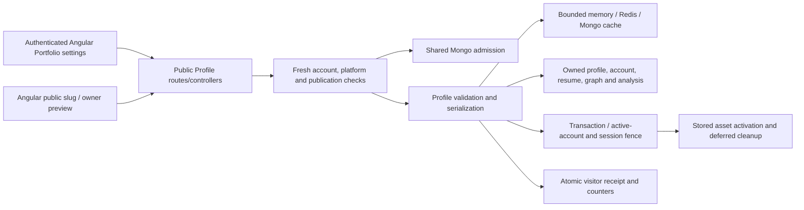

# Public Portfolio audit and local finalization — 2026-11-08

**Release status: BLOCKED.** The implemented fixes pass focused local verification. This is not staging or production acceptance. The approved legacy analytics index is now implemented and locally verified; browser, live storage, email and deployment acceptance remain unverified.

## Scope, authorization and evidence

- Started from clean `release1`, commit `01c53014f7f90875022b87ebf5cb45eca45655a5`.
- Created the explicitly authorized `fix/finalize-public-portfolio` branch. PR target: not applicable. No commits, pushes, merges or deployments.
- Inspected actual routes, controllers, services, models, Angular components/templates/styles, API clients, ownership utilities and tests. Preserved earlier verification reports and historical records.
- No environment files, AI configuration, dependencies, public response schemas, routes, stored identifiers or production data changed.
- Local integration uses a new loopback MongoDB replica set, disposable databases, loopback Redis 7.0.15, owned upload fixtures and separate backend worker processes. The runner blanks configuration-file environment entries before applying explicit fixture settings. It never uses the application's configured database URI.
- Historical `backend/verification/public-portfolio/REPORT.md` describes an earlier implementation. Its Redis quota and nontransactional analytics descriptions are not the current architecture. Do not treat that older VERIFIED label as present production acceptance.

## Actual architecture and working flow



Public pages use `/p/:slug` and the existing `/public/:slug` alias. Owner settings remain `/app/portfolio`. The Angular public-profile service deduplicates only in-flight reads; it does not retain completed public responses. Slug, preview, authentication and invalidation changes cancel superseded reads. Account changes clear owner state; cross-tab notifications invalidate consumers and preserve unsaved-draft warnings.

`publicProfile.routes.js` mounts no-store responses, slug validation, JWT protection on owner writes/reads, optional identity on anonymous profile reads, Mongo admission and upload validation. Controllers delegate to `publicProfileService`, cache invalidation, contact and storage services.

| Endpoint                                     | Policy and data flow                                                                                                                  |
| -------------------------------------------- | ------------------------------------------------------------------------------------------------------------------------------------- |
| `GET /api/public-profiles/me`                | Authenticated owner, private payload, media session; creates an unpublished profile when absent                                       |
| `PUT /api/public-profiles/me`                | Authenticated owner only; bounded validated fields; transactional notification/profile/asset changes                                  |
| `POST /api/public-profiles/me/project-image` | Authenticated owner, quota, strict decoded image validation, owned generated storage reference                                        |
| `GET /api/public-profiles/me/analytics`      | Owner-only counters and seven UTC calendar days                                                                                       |
| `GET /api/public-profiles/me/resume`         | Owner-only current default owned PDF                                                                                                  |
| `GET /api/public-profiles/:slug`             | Fresh global visibility, publication and active-account checks before cache; owner-only preview bypasses public cache                 |
| `GET /api/public-profiles/:slug/resume`      | Fresh publication, account, CTA visibility and owned default PDF checks                                                               |
| `POST /api/public-profiles/:slug/contact`    | Verified eligible recruiter, active public recipient, no self-contact, sender and recipient quotas, accepted-delivery acknowledgement |

Profile collections are bounded: up to 12 displayed skills/projects/testimonials, 8 experiences and 50 completed courses; server validation also limits submitted arrays and payload size. No public server search or paginated collection endpoint exists, so a new text-search/pagination index is not justified.

## Verified privacy, security and recovery controls

- JWT validation and current account/session ownership remain in the existing authentication middleware. Owner IDs come from authentication, not submitted IDs.
- Public serialization excludes email, phone, analytics, private Weekly Report momentum, hidden collections, hidden courses and hidden resume CTA data. Successful owner previews remain private/noindex and bypass public cache.
- Fresh publication/account/platform checks run before warmed cache access. Integration checks cover edits, account changes, renamed slugs, unpublication, inactive accounts and global visibility revocation on warmed workers.
- Payload validation rejects markup, dangerous URL schemes, embedded URL credentials, malformed visibility and excessive collections. Angular renders bound text without HTML trust bypasses.
- Uploads accept one PNG/JPEG/WebP image, at most 2 MiB. Sharp must decode it, enforces pixel/concurrency/time bounds, strips metadata and emits bounded WebP output. SVG, forged bytes, empty files and oversized payloads are rejected.
- Resume access verifies surviving owned files and confines resolved filesystem paths, including symlinks, to the upload root. Downloads use no-store and nosniff. Managed B2 references are owner-bound.
- Managed assets use durable receipts, transactional activation, exact references and bounded retryable cleanup. Account deletion and mutations share the existing owner fence.
- Recruiter contact does not accept arbitrary destination addresses. It uses authenticated sender identity, sanitized text and a honeypot. Errors do not produce a false success. Unit tests simulate SMTP acceptance; no actual mail was sent.
- Mongo admission fails closed with 503 on coordination outage and uses 429/Retry-After for exhausted quotas. Redis is an optional cache, not the current rate-limit authority.

## Implemented fixes

| Defect                                                                                        | Change and proof                                                                                                                                                                                                                                                                                                                                                                   |
| --------------------------------------------------------------------------------------------- | ---------------------------------------------------------------------------------------------------------------------------------------------------------------------------------------------------------------------------------------------------------------------------------------------------------------------------------------------------------------------------------- |
| A session revoked after route authentication could still commit a Portfolio save              | Forward the authenticated session revision to the existing notification transaction fence and the managed-asset transaction fence. The latter now also checks active-account state. Unit checks cover wiring and safe 401 mapping; disposable Mongo checks reject stale revisions on both commit paths without persisting the mutation. No new coordination model or token format. |
| Controller converted a transaction's session rejection to 500                                 | Preserve supported internal status values while retaining the generic public error body. Regression checks assert 401 and no internal-message disclosure.                                                                                                                                                                                                                          |
| Backend could accept reserved slug `me`, which collides with the owner route                  | Reject manually submitted normalized `me`; automatically allocate `dev-me` for that name. Existing records are not renamed. Tests cover both normalization and allocation.                                                                                                                                                                                                         |
| Repeated daily refreshes attempted write transactions before hitting the unique visit receipt | Check the indexed committed receipt first. The existing unique index and transaction remain authoritative for concurrent first views. Tests assert the duplicate fast path performs no transaction; real Mongo verifies five concurrent calls plus ten repeats yield exactly one receipt and one increment of each counter.                                                        |
| Public display invented professional titles and accreditation                                 | Animate only the owner's saved headline/job title. Use neutral missing-title and missing-provider text. No fabricated Specialist/Architect/Accredited fallbacks. Tests cover absent and authored values.                                                                                                                                                                           |
| Owner preview recognition depended on fields intentionally removed by display serialization   | Recognize a successfully authorized preview without matching GitHub usernames or requiring leaked email/ID fields. Regression covers an owner with no GitHub identity.                                                                                                                                                                                                             |
| Clipboard rejection/late completion could produce unhandled or stale UI updates               | Handle unavailable/rejected clipboard operations, unpublished links and completion after account/slug/component changes; track and clear feedback timers. Clear publication/share state during owner reloads.                                                                                                                                                                      |
| Animated content and smooth scrolling ignored reduced-motion preference                       | Render the authored role statically and disable scoped animations/transitions/smooth scrolling for reduced motion. Unit checks cover the static role behavior.                                                                                                                                                                                                                     |

## Cross-module ownership, AI and synchronization

Public rendering does not call an AI provider. The standalone portfolio-scoring prompt file is not invoked by these routes. Owner momentum can consume an existing Weekly Report summary; the public serializer removes it. Provider configuration and response contracts were left unchanged.

`developerSignalService` exposes owner Portfolio completeness/projects/skills to Dashboard, recommendations, Simulator, Weekly Reports, Skill Gap and Career Sprint. Portfolio skill entries remain claims; completion does not award verified proficiency, XP or readiness. Current-context and Skill Gap consumer contract tests passed. Frozen Career Sprint implementation was untouched; no Career Sprint infrastructure acceptance is implied.

Selected owned resume analysis is resolved through the existing developer context service; public resume download separately follows the owned **default file**. Those are distinct existing selection policies. Tests verify ownership and context isolation rather than forcing those selections to match.

Updates invalidate existing dependent local caches and broadcast frontend invalidation. Public cache correctness across workers uses content revisions. An end-to-end deployment test of every downstream consumer's cache freshness was not performed; bounded consumer cache behavior remains its own contract.

## Cache, concurrency and scalability

Memory capacity is 200 payloads/worker. Redis and Mongo retain payloads for one hour with five-minute freshness. Keys include profile content and the selected account fields; counters do not churn content revisions. Owner previews never enter shared cache. A stored Mongo payload is unique per profile; key mismatch prevents serving an obsolete revision.

Local single-flight bounds concurrent rebuilds. Redis uses a ten-second NX lease, token-checked deletion and at most twenty 50 ms polls. Integration verifies one build across separate Node processes and visibility of edited content. This is an advisory cache rebuild lease: Redis outage or an expired lease can permit duplicate computation. Content-addressed keys protect correctness; this is not a globally fenced exactly-once workload. There are no paid AI calls in that loader.

Mongo quotas preserve existing policies: public views 60/minute/IP, resumes 10/minute, owner reads/analytics 30/minute, mutations 20/minute, uploads 10/hour, recruiter contact 3/hour/sender and 20/day/recipient slug. Fixed windows use shared Mongo state and TTL expiry. Express proxy trust determines anonymous identity and must be verified in deployment.

Analytics HMAC hashes profile/day/IP/user-agent. Owner, preview, HEAD, bot and incomplete traffic are excluded. Current receipts and counters commit together; visitor-day deduplication means counters are not raw page-refresh counts. Work is best effort with bounded in-flight work; outages can lose views. Existing legacy records are retained.

### Measured local fixture results

Source: `query-measurements.json`, `final-query-measurements.json` and integration TAP. These are local observations, not service SLOs or production capacity measurements.

| Measurement                                      | Initial query run | Final query/security run                        |
| ------------------------------------------------ | ----------------- | ----------------------------------------------- |
| Cold cache module read                           | 62.323 ms         | 61.387 ms                                       |
| Warm memory p50 / p95, 50 reads                  | 0.074 / 0.274 ms  | 0.173 / 0.480 ms                                |
| Payload loader calls / total reads               | 1 / 52            | 1 / 52                                          |
| Observed cache hits                              | 51 / 52 (98.08%)  | 51 / 52 (98.08%)                                |
| Published slug / owner lookup docs examined      | 1 / 1             | 1 / 1                                           |
| Receipt point lookup docs examined               | 1                 | 1                                               |
| Current seven-day query docs examined / returned | 10 / 10           | 11 / 11, including the atomic analytics fixture |
| Legacy seven-day query docs examined / returned  | 1,010 / 10        | 1,010 / 10                                      |

Cache timings exclude HTTP, authentication, quota admission and asynchronous analytics. One new cache instance exercised Redis reuse; integration separately verified Mongo fallback. No production cache hit rate, regional Redis latency or sustained load limit has been established.

### Mongo findings and approved index

`explain('executionStats')` ran against real disposable MongoDB with the existing query predicates and declared indexes. It confirmed indexed slug, owner, receipt and current seven-day queries. The legacy `PublicProfileView` seven-day filter uses only `profileId_1` and examines historical rows before filtering dates. A non-unique `{ profileId: 1, viewedAt: 1 }` index is justified by the measured scan amplification.

The user explicitly approved this additive schema index after reviewing the scan evidence, satisfying [AGENTS.md](../../../../AGENTS.md). The model now declares the non-unique `{ profileId: 1, viewedAt: 1 }` index. Disposable Mongo verification returned the same 10 legacy rows while examining 10 documents instead of 1,010 (99.01% fewer), using `profileId_1_viewedAt_1`. Assertions also confirm the existing partial unique visitor-guard and TTL indexes remain present. Production creation, index inventory, representative production data distribution and execution plans still require an authorized staging/release process. Existing indexes were not removed. The owner-profile lookup index is non-unique; transactional owner fencing serializes application profile initialization. Do not mistake it for a unique userId constraint.

## Remaining issues and production gates

| Gate                                                            | Status                                    | Required action                                                                                                                                                                                                                                                                                                                                                                   |
| --------------------------------------------------------------- | ----------------------------------------- | --------------------------------------------------------------------------------------------------------------------------------------------------------------------------------------------------------------------------------------------------------------------------------------------------------------------------------------------------------------------------------- |
| Focused backend, Angular and TypeScript contracts               | PASS locally                              | Retained commands/results below                                                                                                                                                                                                                                                                                                                                                   |
| Real local HTTP, Mongo transactions, Redis and separate workers | PASS locally                              | 12/12 integration checks                                                                                                                                                                                                                                                                                                                                                          |
| Revoked-session commits and concurrent analytics                | PASS locally                              | Both commit paths reject; one receipt/counter increment                                                                                                                                                                                                                                                                                                                           |
| Legacy analytics scan amplification                             | PASS locally; production creation pending | Approved index implemented; explain verified 10 examined / 10 returned. Stage additive creation and verify production inventory separately                                                                                                                                                                                                                                        |
| Browser viewport/keyboard/visual journeys                       | BLOCKED / not executed this task          | Existing browser harness requires Playwright, unavailable through the checked project/runtime module paths. Historical screenshots do not verify this revision. Run current desktop/mobile/light/dark and reduced-motion journeys with browser tooling.                                                                                                                           |
| Storage opt-in integrations                                     | BLOCKED / two skipped                     | `B2_ACCEPTANCE_MONGO` requires its disposable loopback Mongo fixture (test checks port 27140); `STORAGE_SECURITY_MONGO` requires its own loopback provisioning fixture (27141/replica configuration). These are local opt-in prerequisites, not missing cloud keys.                                                                                                               |
| Live B2 / SMTP                                                  | BLOCKED / not contacted                   | Validate real bucket/version/credential isolation, privacy, cleanup worker and accepted delivery in staging; SMTP acceptance alone is not mailbox delivery                                                                                                                                                                                                                        |
| Reverse proxy, media cookie and persistent storage              | BLOCKED / deployment-specific             | Verify trusted proxy/IP behavior, same-origin routing, cookie attributes, shared filesystem or private B2, permissions and restart recovery                                                                                                                                                                                                                                       |
| Cross-origin frontend/API deployments                           | BLOCKED unless same-origin deployed       | Existing frontend does not opt into credentialed cross-origin image cookies; existing broad CORS setup must not be assumed to authorize private media. Use the supported same-origin proxy or separately approve a shared credentials/CORS policy.                                                                                                                                |
| Real traffic/load, multi-region latency, production indexes     | BLOCKED / not measured                    | Stage representative concurrency, Mongo transaction capacity, Redis outages/recovery and query plans                                                                                                                                                                                                                                                                              |
| Derived skill fallback freshness and meaning                    | OPEN product/data policy                  | Empty owner skill arrays trigger latest graph/analysis fallback. These sources are not all fingerprinted to current career/GitHub context; resume claims receive an existing display weight of 70. Do not present this legacy weight as independently verified proficiency. Approve a provenance/opt-out/current-context contract before changing schemas or historical behavior. |
| Scalar edits from concurrent settings sessions                  | OPEN existing policy                      | Cross-tab invalidation warns on dirty drafts; there is no client-supplied optimistic version for every scalar edit. Last-writer-wins is still possible. A version/ETag contract needs explicit API approval.                                                                                                                                                                      |
| Legacy filesystem image privacy                                 | OPEN existing public-asset policy         | Filesystem image paths are public/cacheable; unlike managed B2 authorization, unpublication does not revoke already public image URLs or downloaded bytes. Validate the chosen deployment/privacy policy before release.                                                                                                                                                          |
| Rich social previews                                            | OPEN optional capability                  | Angular metadata is client-rendered; crawler support is not SSR/prerender acceptance                                                                                                                                                                                                                                                                                              |

## Test commands, outcomes and retained failures

`focused-results.json`, `final-results.json`, `integration-retry-final-results.json`, `query-final-final-results.json` and `security-final-final-results.json` retain exact child commands, exit codes and wall times. TAP/Vitest logs retain test names, timings and available failure stacks.

1. `node --test --test-reporter=tap backend/src/tests/publicPortfolioHardening.test.js backend/src/tests/skillGapConsumerContracts.test.js backend/src/tests/developerContextService.test.js`: first 37/38 passed. The new automatic-slug mock returned an unawaited query object, so the fixture was corrected to return `null`. Final **38/38**, zero skipped, 7,798.6373 ms TAP duration; retained `backend-focused.log` and `backend-final.log`.
2. An earlier test-first run before the security fix observed 19 tests, 16 pass, 3 fail. Its sandbox-TEMP log was no longer accessible when retention was attempted. The original stacks/child exit code are unavailable; they are not reconstructed or represented as retained evidence.
3. From `frontend`: `node node_modules/@angular/cli/bin/ng.js test --watch=false --include=src/app/pages/public-portfolio/**/*.spec.ts --include=src/app/pages/portfolio-settings/**/*.spec.ts --include=src/app/shared/services/public-profile*.spec.ts --include=src/app/shared/utils/public-profile.utils.spec.ts`: **34/34**, five files, 25.42 s reported test duration. `angular-focused.log`; launcher wall time 155,610 ms includes preparation.
4. `node frontend/node_modules/typescript/bin/tsc --noEmit -p frontend/tsconfig.app.json`: exit 0, 27,038 ms wall time; empty `typescript.log` is expected successful compiler output.
5. `node backend/src/scripts/verifyPublicPortfolioFinalization.cjs`: final focused backend passed and production build exited 0. Its first HTTP integration failed before assertions at index creation because C: had only 278,315,008 bytes free against Mongo's 524,288,000-byte minimum. Failure stack retained in `portfolio-integration.log`. No application workaround or reduced database safety threshold was used.
6. `node backend/src/scripts/verifyPublicPortfolioFinalization.cjs --integration-only`: moved disposable Mongo data to D:, retained original failure. **12/12 integration tests**, zero skipped, 32,034.1332 ms TAP duration, 32,562 ms child wall time. `integration-retry-portfolio-integration.log`. Query audit exit 0, 8,144 ms.
7. `node backend/src/scripts/verifyPublicPortfolioFinalization.cjs --query-only`: real session fences, concurrent receipts and cache/query checks exit 0, 9,269 ms. This is an assertion script, not an additional counted node:test suite.
8. `node backend/src/scripts/verifyPublicPortfolioFinalization.cjs --security-only`: final storage contracts **8 pass, 0 fail, 2 opt-in skips**, 3,824.1252 ms TAP duration. Initial sanitized runner had emptied numeric/non-secret defaults and caused one environment-validation failure (7 pass, 1 fail, 2 skip); corrected only fixture defaults, preserved both logs and stacks.
9. From `frontend`: `node node_modules/@angular/cli/bin/ng.js build`: exit 0, 112.837 s Angular duration / 121,758 ms child wall time. Existing unrelated Landing Page SCSS budget warning: 56.67 kB against 48 kB; unchanged. No warning threshold increased.

Automatic approval initially rejected the broader runner because inherited credentials could reach external storage. The replacement explicitly sanitizes environment entries and restricts execution to local fixtures; no cloud test was bypassed or falsely marked verified.

The complete repository regression suite was not run; this task used affected module, storage and shared consumer regressions. AI providers, frozen Sprint implementation and unrelated modules were not changed.

## Exact task-owned source inventory

- `backend/src/models/publicProfileView.js` — approved additive legacy analytics compound index
- `backend/src/controllers/publicProfileController.js`
- `backend/src/services/publicPortfolioAnalyticsPersistence.js`
- `backend/src/services/publicProfileService.js`
- `backend/src/services/storedAssetService.js`
- `backend/src/tests/publicPortfolioHardening.test.js`
- `backend/src/scripts/auditPublicPortfolioQueries.cjs` — reusable disposable query/cache/security assertions
- `backend/src/scripts/verifyPublicPortfolioFinalization.cjs` — credential-isolated local verification runner
- `frontend/src/app/pages/portfolio-settings/portfolio-settings.component.ts`
- `frontend/src/app/pages/portfolio-settings/portfolio-settings.component.spec.ts`
- `frontend/src/app/pages/public-portfolio/public-portfolio.component.ts`
- `frontend/src/app/pages/public-portfolio/public-portfolio.component.html`
- `frontend/src/app/pages/public-portfolio/public-portfolio.component.scss`
- `frontend/src/app/pages/public-portfolio/public-portfolio.component.spec.ts`

All new evidence is under this report's directory. `file-inventory.json` lists its exact retained paths plus source paths. No existing files were moved or deleted. No screenshots were produced by this task. Disposable Mongo files were removed by the fixture's checked, individually enumerated cleanup and only task-owned processes were stopped. Essential passing/failing logs, query plans and historical evidence remain.

Final formatter, syntax, whitespace and inventory results are recorded in `finalization-results.json`. Formatting uses explicit paths and the installed frontend Prettier, with the frontend configuration for Angular sources and matching write/check options for backend files. No repository-wide formatting.

### Final post-format verification

`post-format-results.json` and `final-*.log` retain the final execution after all source edits and formatting:

- Focused backend: **38/38**, zero skipped, 8,181.9734 ms TAP duration / 8,329 ms wall time.
- From `frontend`, `npm test -- --watch=false` with the same four scoped include arguments: **34/34**, five files, 61.66 s reported duration / 185,396 ms wall time including preparation.
- TypeScript: exit 0, 15,804 ms wall time.
- From `frontend`, `npm run build`: exit 0, 138.561 s Angular duration / 149,389 ms wall time. The same unrelated Landing Page stylesheet warning remains.
- Prettier write followed by check: all 13 changed/new source files and this report pass. Seven backend syntax checks pass. Working-tree and staged whitespace checks pass; index remains unchanged.
- Owned fixture cleanup: all three Mongo children stopped; 56, 147 and 95 temporary files removed by their respective checked fixtures. Redis port 27172 was confirmed closed. Its log was retained as `redis-fixture.log`, then only the verified task-owned `/tmp/portfolio-final-27172.log` was deleted. `cleanup-results.json` records this cleanup. No tracked files were deleted or moved.

There are no remaining observed failures in the executed final local test sets. The legacy-query inefficiency has been resolved locally. The remaining unverified infrastructure, browser and deployment gates above still prevent a production-ready declaration.

## Approved index follow-up

The user approved the compound index after the initial report. Earlier query measurements remain unchanged as historical before-fix evidence. Follow-up evidence is retained in timestamped `index-approval-*` subdirectories, keeping previous passing/failing logs intact. Only the legacy model, the two reusable verification scripts and this report/inventory changed in this follow-up; existing source edits were preserved.

The first follow-up HTTP integration stopped at its Redis prerequisite (`Configured Upstash Redis required`). Its independent Mongo query assertions passed, as did 21/21 hardening tests. The runner subsequently found the local Redis port closed during shutdown. This is retained as a fixture failure, not hidden or attributed to the model index. The revised fixture keeps Redis in a foreground child process and explicitly waits for loopback readiness; application timeout and quota settings are unchanged.

For an authorized staging/production release, inspect `db.publicprofileviews.getIndexes()` and create the missing matching index additively on the explicitly selected database:

```javascript
db.publicprofileviews.createIndex(
  { profileId: 1, viewedAt: 1 },
  { name: "profileId_1_viewedAt_1" },
);
```

Do not use `syncIndexes()` or remove existing indexes. Verify creation completion and the actual seven-day query plan under representative staging load. No staging or production index command was executed by this task. No API, dependency, document field, TTL or uniqueness policy changed. Frontend tests/build results above remain from the preceding finalization; this backend-index follow-up does not rerun unrelated Angular work.

### Final approved-index results

Command: `node backend/src/scripts/verifyPublicPortfolioFinalization.cjs --index-followup`. Final evidence: `index-approval-2026-11-08T10-34-25-300Z/`.

- HTTP integration: **12/12**, zero skipped; 76,175.2688 ms TAP / 76,376 ms child wall time.
- Portfolio hardening: **21/21**, zero skipped; 20,480.8642 ms TAP / 20,877 ms child wall time.
- Query/cache/session/concurrency assertions: exit 0, 19,215 ms wall time. Legacy winning index: `profileId_1_viewedAt_1`; 10 keys and 10 documents examined, 10 rows returned. Existing partial-unique and TTL index checks passed.
- All three final child commands exited 0. Exact commands and timings are in the subdirectory `query-final-final-results.json`; the full explain plans and index inventory are in `final-query-measurements.json`.
- The failed initial follow-up is retained in `index-approval-2026-11-08T10-30-37-570Z/`: HTTP Redis prerequisite failure, independent query assertions exit 0, hardening 21/21, plus a subsequently observed Redis shutdown connection-refused error. No failed evidence was overwritten.
- Both disposable Mongo fixtures stopped and removed only owned files: 96 and 167 respectively. Final `mongo-cleanup.json` and `redis-cleanup.json` confirm cleanup. Redis log retained; the task-owned temporary original was removed.
- Follow-up source inventory adds `backend/src/models/publicProfileView.js` to the preceding 13 source files. Only that model, `auditPublicPortfolioQueries.cjs`, `verifyPublicPortfolioFinalization.cjs`, documentation and evidence changed in this approval follow-up. See updated `file-inventory.json`. No document data, API shape, environment setting or production index was modified.
- `index-followup-finalization.json` records scoped formatting, syntax and Git whitespace checks. Angular/TypeScript/build results remain the previously verified revision because this follow-up changes only backend index metadata and verification scripts.
