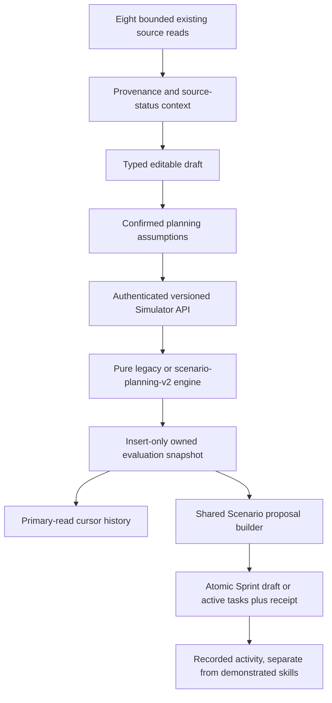

# Scenario Simulator implementation and acceptance

25 October 2026, Asia/Karachi. Scope: the reviewed Scenario architecture and coordinated additive Sprint/Developer Signal boundaries. The initial repository contained only the untracked architecture review from the preceding assessment. That report is preserved unchanged.

## Architecture and decisions

The permanent root charter is the decision reference. No scoring rule in GitHub, Resume, portfolio, Skill Gap or Sprint progress/XP/streak engines was changed. No production data/index operation, destructive migration, new dependency, collection, microservice or queue was introduced.



V2 calculations deliberately use **plan-only context**: explicit assumptions and frozen static tables, with no upstream numeric baseline or provider-connectedness bonus. Canonical source context informs suggestions/display and remains independently fingerprinted; it cannot silently change a saved evaluation. This is a deliberate refinement of the review's context policy: a constant calculation-context fingerprint is correct when observations do not participate in calculation. No automatically selected “owned metric” is relabeled a hiring score. V2 supports the explicit user-assumption branch.

Legacy numerical behavior remains in a pure module with frozen copies of original tables/effort rules. The service facade no longer imports a database-heavy implementation into the engine. Exact accepted versions are `scenario-planning-legacy-v1` and `scenario-planning-v2`; unknown versions fail validation. Previously stored records remain unversioned and unchanged. Newly evaluated legacy responses add reproducibility metadata without changing central calculations.

V2 canonicalizes skill/project identities, ranks nominal contributions before diminishing factors, preserves valid zero, rejects coercions/unknown fields/conflicting duplicates, protects dictionary lookup from inherited object keys, and uses the same 0.8 effort capacity for duration suggestions. Existing weights, caps, synergy and overload coefficients remain unchanged. Confidence/ranges remain compatible numeric fields explicitly labeled uncalibrated heuristics. They are not hiring probabilities or verified proficiency.

Context has four-source fan-out, source and total deadlines, query maxTimeMS/AbortSignal, unavailable-connection rejection, 32-pipeline/256-joiner admission bounds and no cross-request result cache. Eight source statuses preserve healthy partial results. Selected Resume ownership is resolved before analysis lookup; Skill Gap compatibility reuses its existing owner contract, including selected source revisions. Claims, inference, recorded observations, activity, intent and market context are distinguished. Missing/stale/incompatible data never becomes a baseline measurement.

Successful reads are not aborted during cleanup; cancellation is reserved for deadlines and caller cancellation. A regression test protects that lifecycle. Recommendation eligibility is checked per record rather than treating an entire batch as fresh because its newest entry is fresh. Selected Resume identity remains explicit even when that selection has no analysis.

Snapshots use existing user/hash uniqueness and `$setOnInsert`, including explicit initial timestamps and no duplicate-update timestamp mutation. They contain normalized inputs, exact engine/table versions, calculation context and original result, bounded to 64 KB. History revalidates Mongo with stable createdAt/ID cursors. Legacy hash semantics are preserved; v2 uses a namespaced evaluation hash. No destructive history backfill is needed.

The real history experiment in `history-index-experiment.json` used 1,000 synthetic evaluations: the former index examined 1,000 keys/documents to return 20 rows; `{userId:1,createdAt:-1,_id:-1}` examined 20. Measured query execution was 20 ms versus 6 ms on this host. That evidence justified one cursor index. Production auto-indexing is disabled for this model; saves/history fail closed with 503 until the full unique index and cursor index have been verified. A partial/sparse unique index does not satisfy the write gate.

One proposal builder serves both Simulator and Career Sprint callers. Existing direct export defaults to active incomplete tasks; the new UI explicitly saves then creates a reviewable draft. Source binding rejects mismatched owned IDs. Target-calendar dates remain inside the Sprint, including DST windows. An embedded receipt and work IDs commit with work in one optimistic save. Stable item identities survive edits/deletes and cross-mode ingestion. Receipts are retained for the Sprint lifetime, bounded at 128; provenance is bounded at 500 items. At capacity the API rejects rather than silently evicting replay protection. Explicit repeat-as-new operation IDs are not exposed; users can choose another Sprint.

The shared builder adopts the existing Career Sprint import's task-point mapping (first two skills 5 points, later skills 4; project complexity 4/5/6). This resolves the prior two-builder disagreement without changing XP/progress formulas. Historical exports lacking stable item IDs return a review-required 409 rather than guessing identities or creating duplicates; original work remains unchanged.

Automatic target selection mirrors the Sprint owner's active-window priority through ID-only owned reads, with the existing Sprint creator as the empty-state fallback. It does not load the full overview, execute analytics, or apply inactivity/streak writes. The persistence test verifies the selected document remains unchanged by target lookup.

Developer Signal Service retains the old `completedSkillSignals` field as an empty compatibility projection. Self-reported completed tasks appear in `recordedActivitySkills`; a goal or incomplete task contributes no completed skill. Saved Scenarios explicitly carry planned-intent/non-proficiency metadata. Locked evidence engines and downstream response shapes remain intact.

Frontend types and a feature service separate draft payloads from evaluated/saved results. Dirty or legacy results cannot be saved/exported as current v2 evaluations. Account/profile request generations, teardown cancellation and pending-only account-scoped reads prevent stale cache writes. Failed refresh retains prior evaluations. Baselines require visible confirmation. History pagination and comparison limitations are explicit.

Visual inspection found pre-existing fixed dark surfaces using Light-theme text, and a verifier capturing an unfinished resize transition. Simulator styles now use existing theme surface/text tokens, including native options, the new confirmation control and semantic score labels. The final verifier reloads at each viewport/theme and checks actual component bounds before capture. Shared shell and locked styles are unchanged; this is not a comprehensive accessibility certification.

Existing optional Redis provides atomic shared quota counters; no new Redis dependency was added. Production defaults to rejecting Scenario requests when shared quotas are unavailable. `SCENARIO_LIMIT_MODE=single-instance` explicitly permits the bounded local limiter for a single-instance deployment. It must not be set on a scaled deployment. JWT owner keys are hashed; quotas and metrics have bounded namespaces. Live shared Redis capacity remains a deployment gate.

## Stage gates and verification

| Gate | Evidence / result                                                                                                                                                                                                                                                                                                                                                                                   |
| ---- | --------------------------------------------------------------------------------------------------------------------------------------------------------------------------------------------------------------------------------------------------------------------------------------------------------------------------------------------------------------------------------------------------- |
| P0   | Initial 15/15 characterization/existing Scenario tests passed before engine changes. Golden fixtures preserve the prior order/hash collision and zero/coercion defects, without endorsing them. The preceding review records baseline/cache/failure/export reproductions at the same initial source revision.                                                                                       |
| P1   | V2 mathematical and strict-validation fixtures pass, including 1,000 seeded full-result repeatability/bounds cases. Eight independent source failures retain seven healthy source results. Timeout abort/recovery and selected-context exclusion are tested. Disposable Mongo verifies the actual unique index, 100 concurrent immutable saves, owner isolation and cursor traversal.               |
| P2   | Disposable Mongo verifies 50 concurrent exports, one receipt/item set, replay after edit/delete, foreign-owner rejection, calendar bounds, zero XP/completion and cross-mode draft ingestion. Focused Angular state/cache tests passed; full frontend regression passed 383/383 before final focused changes.                                                                                       |
| P3   | Two real Node workers verify 100 concurrent saves, 50 exports, restart replay and fresh history. Authenticated built-frontend browser verifies evaluate/dirty guard/save/draft export and desktop/mobile rendering. Local mixed/burst load completed 2,200 authenticated requests with no unexpected 5xx. Shared-counter/fail-closed tests use controlled infrastructure, not a live Redis service. |

The sandbox denied WiredTiger and Vitest temporary-file renaming. The same disposable tests ran successfully outside the sandbox. One initial export test caught a genuine missing ingestion guard and passed after correction. The first load harness failed parsing a plain-text quota response; the middleware now consistently returns JSON and the workload distributes operations independently of account identity. No assertions or performance thresholds were weakened to conceal those failures.

A later 136-test regression pass had one fixture-format failure: JSON stores the original engine's negative zero penalty as positive zero. The golden test now checks the original negative-zero sign explicitly as well as exact serialized equality. The implementation was not changed to hide that result. Independently, 5,000 comparisons against the original Git revision matched every retained mathematical field; thirty pre-extraction golden cases are committed as test fixtures.

Retained `integrated-results.json` contains actual local indexes, request counts, statuses and per-operation p95/p99. Two essential browser PNGs are retained. No session token or production URI is written to evidence. The standalone verifier starts its own loopback mongod and never loads `.env`. Test database directories are created with a unique task prefix, checked for containment and removed after process shutdown.

## Acceptance limits and production blockers

Local results do not establish the review's production deployment assumptions. Remaining gates:

1. Verify deployed package versions, actual production indexes/duplicate inventory, Mongo topology/write concern, pool limits and gateway/proxy trust. No production connection was used here.
2. Run the 15-minute two-instance target workload, full burst duration and 60-minute soak on deployment-equivalent hardware. The retained run is a 60-second 20 RPS baseline and 10-second 100 RPS burst on this Windows host, not the full capacity target.
3. Verify real shared Redis counters/outage/reconnect across application instances in an isolated service. Controlled atomic-counter tests and production fail-closed behavior are not a live distributed-service benchmark.
4. Exercise real driver/network stalls, pool exhaustion and sustained abort recovery. Adapter-level deadline tests and successful real Mongo reads do not prove every network failure mode.
5. Resolve the separately retained Career Sprint release/lock performance gates; this work does not certify an unrelated blocked release as ready.

No statistical prediction claim is authorized. Existing overload/synergy/static-demand heuristics retain their limitations. Schema declarations are not proof of production index installation.

## Deployment and rollback

Deploy additive readers/schema fields before v2 UI adoption. Keep unknown-version rejection and legacy readers. Ensure the full unique `{userId,scenarioHash}` index exists before enabling saves. Audit duplicates read-only and coordinate any repair separately; do not run the existing destructive migration as a verifier. Run `backend/src/scripts/auditScenarioSimulationSnapshots.js` only with an explicitly configured `SCENARIO_AUDIT_URI` using read-only credentials. It does not load `.env`, import auto-indexing models, create indexes or modify records.

Create the measured cursor index as a separately reviewed deployment operation:

```javascript
db.scenariosimulations.createIndex(
  { userId: 1, createdAt: -1, _id: -1 },
  { name: 'scenario_history_cursor' },
);
```

Do not use `syncIndexes` or automatically drop the former history prefix index. Review index usage and retire it separately after rollout. Production startup does not build Scenario indexes. The read-only audit must establish uniqueness first; duplicate repair is outside this non-destructive implementation.

Configure existing Redis normally for multi-instance production. An unavailable shared limiter returns 503/Retry-After. Explicit single-instance mode is only an operationally constrained fallback. Existing global auth/IP protection remains in place.

On rollback disable new v2 writes/UI while retaining readers for v2 documents and Sprint receipt/provenance fields. Do not roll back to a writer that drops those fields or overwrites snapshots. Keep snapshots, receipts and original results; never rewrite them to legacy versions. No database rollback migration is required.

Exact added/modified paths and hashes are retained in `file-inventory.json`. No source files were moved or deleted. The initial untracked architecture review was not edited. No unrelated user work, historical evidence, source assets or licenses were removed.

Final post-cleanup validation and status are recorded below. All source changes were formatted with explicit paths in write mode and then checked with the same options. Backend JavaScript syntax, TypeScript and Git whitespace checks passed. No task-owned temporary source scripts or obsolete screenshots remain. Standard Angular build output is retained under `frontend/dist/frontend` because the authenticated browser verifier uses it.

## API integration reference

Existing route wrappers and unversioned numerical clients remain supported. New clients post `ruleVersion: scenario-planning-v2`, `baselineAuthority: user-assumption`, `baselineConfirmed: true`, finite numeric baselines, integer duration, supported role/level and bounded skill/project arrays to `/api/simulator/what-if`. The returned `result.evaluation` must accompany the same plan when posting `/save`; altered envelopes or draft inputs return 409. Save replay returns the original owned snapshot, including its original display name and timestamps.

Re-running unchanged v2 assumptions returns the same evaluation identity. A new rule version or changed planning inputs creates another snapshot; elapsed time alone does not manufacture a new calculation. Historical results are never recalculated on read. Legacy results require explicit v2 assumption confirmation before new UI save/export.

`GET /history` retains `history` and adds `nextCursor`. Pass that opaque cursor with the next bounded limit. `POST /create-sprint` accepts an owned `scenarioId`, optional owned `sprintId`, and explicit `mode: draft` or `active-tasks`; omitted mode retains legacy active-task behavior. The new UI chooses draft. Replay returns the original receipt/work IDs with zero newly added work. Foreign IDs are not found; mismatched source/input, legacy read-only Sprints and ambiguous historical export identities fail safely. No completion, XP or proficiency is granted by export.

## Final results

| Check                                      | Final retained result                                                                                                                                                 |
| ------------------------------------------ | --------------------------------------------------------------------------------------------------------------------------------------------------------------------- |
| Affected backend matrix                    | **136/136 passed**, zero failures/skips; `backend-tests.txt`                                                                                                          |
| Final index/persistence/worker gate        | **6/6 passed**; `final-persistence-tests.txt`                                                                                                                         |
| Final source failure/lifecycle gate        | **4/4 passed**; `final-context-tests.txt`                                                                                                                             |
| Final real source-selection/freshness gate | **1/1 passed**; `final-context-mongo-tests.txt`                                                                                                                       |
| Final mutation-target/export/worker gate   | **2/2 passed**; `final-export-tests.txt`                                                                                                                              |
| Frontend regression                        | Full run **383/383 passed**; final focused state/cache run **4/4 passed** in `frontend-focused.txt`                                                                   |
| TypeScript / production build              | Passed; `frontend-build.txt` retains the existing unrelated Landing Page 55.89 KB / 48 KB stylesheet warning                                                          |
| Authenticated browser                      | Real routes/JWT/disposable Mongo, evaluate/dirty guard/save/draft export; final Light desktop/Dark mobile captures inspected; actual settled component bounds checked |
| Numerical compatibility                    | 5,000 original-source comparisons matched; thirty golden fixtures retained; 1,000 seeded v2 invariant/repeatability cases passed                                      |
| Formatting / syntax / whitespace           | Explicit-path write/check, changed backend `node --check`, TypeScript and staged/unstaged whitespace checks passed                                                    |

These are separate focused runs, not a claim that all their repeated cases represent additional unique tests. The full frontend run preceded final scoped visual/copy refinements; the final build, focused tests and browser verification cover those changes. No unrelated full suite was repeatedly run.

Final local measured workload: **2,200 authenticated requests**, all 200/201, no unexpected 5xx. Steady phase: 60 seconds at 20 RPS; burst: 10 seconds at 100 RPS. P95 milliseconds:

| Operation  | Steady | Burst |
| ---------- | -----: | ----: |
| Context    |  45.72 | 39.16 |
| Evaluation |  23.91 | 23.69 |
| History    |  35.64 | 27.44 |
| Save       |  44.93 | 33.96 |
| Export     | 137.76 | 52.61 |

The final figures are from `integrated-results.json`. `burst-capacity-failure.json` preserves an earlier failed burst with 75 admission-limit 503s. `export-latency-before-target-lookup.json` preserves the prior 597.37 ms steady export p95. Successful-read cancellation and full-overview target lookup were corrected and the unchanged workload rerun; those earlier failures are not discarded. The final short run meets the stated local latency thresholds for its fixture workload. It does not establish long-duration, deployment-equivalent capacity, full healthy-source profile load or a monthly SLO.

**ARCHITECTURE IMPLEMENTED: YES**

**SCORING & BASELINE CORRECTNESS: PASS** — v2; historical/legacy numerical behavior is deliberately preserved and characterized.

**CONTEXT & EVIDENCE INTEGRITY: PASS** — tested source, selection, failure and intent boundaries.

**IMMUTABLE SNAPSHOTS & IDEMPOTENCY: PASS**

**CROSS-MODULE INTEGRATIONS: PASS** — tested owned Sprint and locked-consumer contracts; no broader release certification.

**MULTI-INSTANCE RELIABILITY: FAIL** — the complete production gate is unverified. Two-process Mongo concurrency/restart checks pass; live shared quota and deployment fault/soak acceptance remain open.

**READY TO LOCK LOCALLY: NO** — the requested complete P3 acceptance package still has the explicit gates above.

**READY FOR PRODUCTION: NO**
